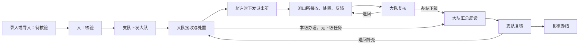

# 情报线索录入、下发、处置和反馈闭环

完整版本范围、发布验证与升级方式见 [0.0.7 版本说明](0.0.7-版本说明.md)。

`0.0.6` 新增迁移 `0024`，将线索收录、按组织层级下发、承办处置、逐级反馈和复核办结串联。旧的本组织核查工单与历史保留，新的跨单位流转使用独立下发记录，避免改变旧工单含义。

## 先维护组织与权限

超级管理员在“组织管理”设置组织类型及上级：**市局/支队 → 分局/大队 → 派出所**。类型未明确的旧组织保留“其他组织”，不会根据名称猜测层级。上级类型不能低于下级，组织层级仍不能用于直接浏览其他单位全部业务数据。

市局/支队可选择启用的下级分局/大队，包括跨过中间组织直接选择大队；不会直接下发派出所。分局/大队可选择下级大队或获准的派出所。系统按组织树及每条线索的下发限制校验，不能通过手工构造单位 ID 下发给无关单位或上级。

| 权限 | 用途 |
| --- | --- |
| `intelligence.read` | 查看本级原线索及本单位参与的下发/接收记录 |
| `intelligence.write` | 手工录入与原线索核验；旧核查工单的兼容操作 |
| `intelligence.import` | Excel 预览、确认和导入记录 |
| `intelligence.dispatch` | 下发、继续下发、本单位指定/转交承办 |
| `intelligence.dispose` | 接收、记录处置和提交反馈 |
| `intelligence.review` | 在本单位作为下发方时复核、退回或办结下级反馈 |

新增操作需同时有 `intelligence.read`。兼容“业务用户”角色保留其原办理范围并补充四项新操作；自定义角色需由管理员明确授权。拥有组织层级关系不代表自动获得操作权限。

## 页面工作区

- **本级线索**：人工录入和本组织导入的原线索，先核验后下发；查看来源、原文、重要程度和建议期限。
- **收到的线索**：上级下发给本单位的记录，可按状态、本人承办和逾期未办结筛选。
- **我下发的线索**：本单位下发记录、下级处置进度和待复核反馈。
- **Excel 导入 / 记录**：模板、文件解析、逐行预览、确认和批次记录。

## 录入和 Excel 导入

人工录入包括标题、来源、线索内容、重要程度和建议反馈期限。编号可手填，留空自动生成；编号在本组织内唯一。旧线索未补编编号时显示“历史线索”。

Excel 使用下载的六列表头：**线索编号、标题、来源、线索内容、办理期限、重要程度**。编号/标题/来源/内容必填；期限用 `YYYY-MM-DD` 文本，重要程度填“普通”或“重要”，空值按普通处理。每次最多 200 条、文件 2 MB、文本总量 200 万字符。模板不包含真实或预置业务数据。

文件在可取消 Worker 中解析，先检查 ZIP 和解压预算，20 秒超时停止；拒绝公式及不支持的单元格类型。预览显示 Excel 行号和错误，文件内重复或本组织已有编号拒绝；存在错误时整批不写入，修正文件后重新导入。确认时服务端再次检查并在一个事务中新增记录、来源批次、事件、审计和幂等记录，不覆盖原线索。导入不自动核验、不自动下发。

## 下发限制和接收

原线索核验后选择“下发线索至下级单位”，填写接收单位、办理要求和反馈期限。普通线索默认也不允许派出所，确需继续下发时明确勾选；**重要线索禁止下发派出所**。下级只能收紧限制，不能放宽上级“不允许派出所”的决定；后续每次下发都由服务端验证。

下发记录保存来源快照，后续原线索变更不会静默替换已下发原文。接收单位可由有处置权限的人员“接收并由我承办”，也可由本单位下发权限人员指定/转交给本单位具有处置权限的启用账号。待复核或已办结时禁止转交。转交后旧承办人不能再登记处置或提交反馈。

只会展示本单位参与的流转、明确的上级链路和本单位下发记录的下级办理链；无关单位不能猜测 ID 获取原文。接收单位获得的是该次下发快照和办理要求，不会因此获得源单位其他案件、线索或个人资料的查询权限。既有案件关联仍遵循原有双方组织和业务权限约束。

## 处置、反馈和逐级复核

下发记录状态为：`OPEN` 待接收 → `PROCESSING` 处置中 → `PENDING_REVIEW` 待复核 → `CLOSED` 已办结；下发方可将待复核反馈退回为 `RETURNED`，承办人补充后再次提交。原组织内核查工单保持旧状态和旧接口。

当前承办人登记处置记录，提交反馈时必须填写处置经过、反馈内容和结果。办理期限仅作业务提示，不自动认定完成；“逾期未办结”按北京时间判断。

有下级流转时，必须先复核办结全部下级反馈，再向上级提交汇总反馈。下级期限不得晚于上级；未填时继承上级期限。下发方具有复核权限的账号可退回或办结，反馈提交人不能复核自己的反馈。每次意见、结果和原文快照均保留，退回重报不会覆盖上一轮反馈历史。

版本条件更新与幂等键保护接收、下发、处置、反馈、复核及转交；同一线索不能同时重复下发给同一单位。父级下发和反馈竞争同一版本，防止“尚未发现下级任务”时被并发越过。历史与审计同事务提交；事件表和导入批次在运行数据库权限中只追加，不开放更新/删除。

未办结流转涉及的组织及其上级子树不允许改变组织类型或归属，防止办理中变更层级破坏原下发边界；组织改名仍按既有规则操作。普通组织管理不会自动撤回或删除流转。

## 升级与验证

停止旧程序并备份，升级至 `0024`，再设置组织类型、上级与角色。迁移增加组织类型、线索编号/重要程度/导入来源、下发与反馈事件表，保留旧数据、旧工单和默认权限含义；不自动下发旧线索或猜测历史组织类型。不提供会丢失下发/反馈历史的降级，回退使用核验过的匹配备份。

本轮使用合成 SQLite、组织和账号验证支队—大队—派出所的导入、核验、下发、接收、处置、反馈、逐级复核及办结；覆盖重要限制、跨范围拒绝、重复下发、幂等、版本冲突、来源快照、转交、审计失败回滚及组织变更保护。

实际结果：后端完整基线 157 项通过，13 项 PostgreSQL 集成用例因未提供独立连接而跳过；最终新增组织互斥/承办转交等调整后，闭环与管理专项 16 项通过（与完整基线存在重叠，不相加为总数）。前端 38 项、浏览器 14 条流程、类型检查与生产构建通过。全新 SQLite、`0023 → 0024` 升级及 Alembic 模型一致性检查通过，未升级用户现有数据库、未重新构建 Docker 镜像，也未代替正式岗位、数据保留和业务审批制度。

线索下发和办理写操作复用组织/账号管理互斥行，锁后重新检查当前会话、组织和操作权限，避免办理中并发改变层级或撤权；不为此增加后台消息、外部通知或自动办结。
