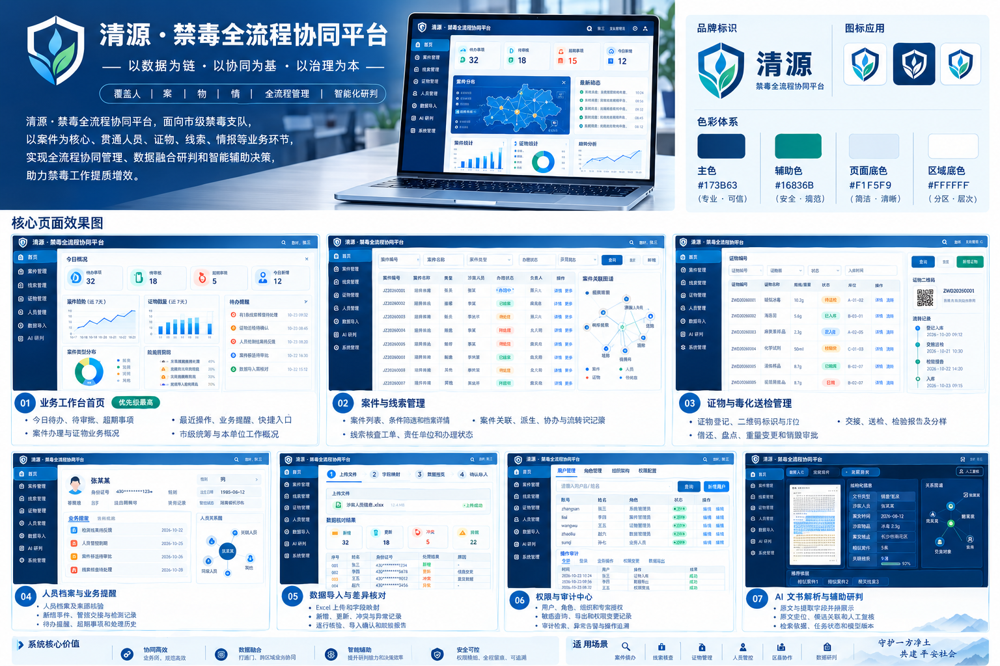

# 清源（Wellspring）·禁毒全流程协同平台总体设计与实施方案（优化版）

> **文档版本：** v2.5.0\
> **修订日期：** 2026-10-28\
> **文档性质：** 总体设计、技术选型、产品命名与视觉基线、分阶段实施方案\
> **适用范围：** 地市级禁毒支队内部业务系统建设论证、技术评审和实施准备\
> **英文名称：** Wellspring Drug Control Collaboration Platform；项目标识：`wellspring`\
> **本轮边界：** 暂不展开商用密码专项设计、测评、预算和验收安排；保留身份认证、HTTPS、密钥管理和备份保护等基础安全措施。\
> **重要说明：**
> 本方案是技术与业务设计建议，不替代主管部门对法律适用、公安信息系统管理、保密、网络安全等级保护、数据分类分级、跨网交换和设备选型的正式审查。涉及人员管控期限、检测频次、措施折抵、证物处置等规则，必须由业务、法制及相关主管部门核准后配置。

------------------------------------------------------------------------

## 0. 执行摘要

### 0.1 建设目标

建设一套面向市级禁毒支队的全流程业务协同系统，围绕"人、案、物、情"形成统一、可审计、可追溯的业务数据链，重点支持：

1.  市级支队对专案、线索、区县业务和跨区域协作的统筹。
2.  案件与人员档案关联、治安/刑事业务衔接和线索核查工单。
3.  毒品证物预约、交接、送检、检验报告、入库、借出、归还、盘点、销毁的全生命周期管理。
4.  上级系统导出文件的受控导入、字段映射、差异核对和增量更新。
5.  本地 AI 对授权文书进行辅助解析、原文定位、人工核验与结构化入库。
6.  经授权的跨区精确线索碰撞与历史案件检索；语义检索和关系图谱按获批选做范围试点。
7.  对离线部署、跨安全域交换、备份恢复、操作审计和供应链安全形成明确控制。

### 0.2 首选技术架构

在“全新建设、主要由外包团队实施、低代码需求未确定、优先控制复杂度、公安内网/离线私有化部署”的前提下，且第 3.10 节环境适配验证通过后，**首选架构为：Vue
3 + TypeScript + FastAPI + PostgreSQL，采用模块化单体业务 API、独立后台
Worker、独立对象存储；首期不引入 NocoBase，不拆分微服务**。

选择这套架构并不是因为它在所有情况下都比 .NET 或 Java
更快，而是因为首期需要在交付可控、数据安全、AI
集成、离线部署和后续维护之间取得平衡。组件数量少、业务写入口唯一、接口和验收边界清晰，尤其适合通过外包合同和技术验收管理交付质量。

推荐基线：

-   **前端：** Vue 3 + TypeScript + Vite，采用成熟 UI
    组件库，构建为可离线部署的静态资源。
-   **业务后端：** FastAPI
    模块化单体，统一承载业务规则、身份上下文、授权检查、事务、审计和 API
    契约。
-   **主数据库：** PostgreSQL 18
    当前受支持的稳定补丁版本为首选；如关键扩展、驱动、备份工具或目标操作系统未通过验证，则退回
    PostgreSQL 17
    当前受支持的稳定补丁版本。以官方支持和依赖兼容性为准，不以"版本越新越好"为唯一标准。
-   **数据访问：** SQLAlchemy 2.x +
    Alembic（具体补丁版本进入依赖锁文件）；所有 DDL
    和数据变更通过版本化迁移管理，禁止在生产环境手工漂移结构。
-   **后台任务：** 首期使用 PostgreSQL 持久化任务表和独立
    Worker，落实幂等、租约、重试、失败队列和监控；达到明确的吞吐或路由需求后再评估消息队列。
-   **文件：**
    独立私有对象存储或经批准的文件存储，数据库保存元数据、校验摘要、权限关联和审计记录，不把大文件直接塞入业务表。
-   **检索：** PostgreSQL
    B-tree、全文检索、`pg_trgm`；确有语义检索需求且完成评测后再部署
    `pgvector`。不因"AI 系统"标签而默认启用所有扩展。
-   **AI：** 基础试点采用已验证的本地 OCR／LLM 独立服务或任务进程；Embedding、Reranker 仅按获批选做范围启用。AI 只生成待核验草稿，不直接改写正式业务事实。
-   **部署：**
    离线制品包、固定镜像摘要、内网镜像仓库、配置与密钥分离、升级回滚和软件物料清单（SBOM）。Docker
    Compose 适用于开发、测试和经批准的单节点部署；高可用能力需另行设计。
-   **低代码：** NocoBase
    暂不进入首期生产基线。待真实需求证明其能减少维护成本，且通过权限、数据库访问、离线升级、许可和安全评审后，再以独立管理工具的方式试点。

### 0.3 备选方案比较与决策

| 方案 | 适用优势 | 本项目的决策与约束 |
|---|---|---|
| A. Vue 3 + FastAPI + PostgreSQL | 业务 API 边界清晰，Python 文档处理与 AI 集成方便 | 环境验证通过且团队具备生产交付能力时首选；以工程质量和验收控制风险 |
| B. Vue 3 + ASP.NET Core + PostgreSQL，Python 承载 AI | 适合已有 .NET 规范、认证基础及 C# 团队 | 若既有约束或供应商能力更适配，应在签约和编码前重新评审；不在实施中临时换栈 |
| C. NocoBase 为主，FastAPI 承载 AI | 部分配置类 CRUD 交付较快 | 首期不采用；核心流程、权限、流水与升级维护的收益尚未证明 |
| D. 首期微服务、多数据库、独立消息平台 | 服务可独立扩展 | 首期不采用；有容量、组织或安全隔离证据后再评估 |

AI 进程采用 Python，不构成业务后端必须采用 Python 的充分理由。最终选择还需比较目标环境适配、团队经验、运维能力和全生命周期成本。

### 0.4 外包交付的强制工程约束

由于主要由外包团队开发，技术选型本身不能替代交付治理。合同及技术附件应明确：

1.  业主拥有完整源代码、数据库迁移、部署脚本、接口文档、自动化测试、构建脚本和运行手册；不得把关键功能封装成无法维护的黑盒。
2.  使用业主可访问的代码仓库、问题跟踪和制品仓库；提交需可追溯，关键分支受保护，禁止只交付最终压缩包。
3.  提交锁定依赖清单、SBOM、第三方许可证清单、漏洞扫描结果、镜像摘要及离线安装包；不得在生产运行时从公网拉取代码、模型或依赖。
4.  必须交付可重复构建、全新环境部署、升级、回滚、备份恢复演练的记录；验收以可复现制品为准，而不是仅看开发人员演示。
5.  业务规则、角色/数据权限矩阵、接口契约、数据库字典和异常处理必须形成文档并由业务方签字确认。
6.  禁止在源代码、镜像和日志中硬编码生产密码、密钥、令牌或真实敏感数据；禁止未经批准将生产数据带出安全域。
7.  付款里程碑与需求基线、代码交付、测试报告、安全整改、运维移交和最终验收挂钩。

### 0.5 版本调整说明

**v2.5.0 相对 v2.4.0：**

1. 保留中文产品名“清源”，英文品牌改为单词 **Wellspring**，英文全称为 **Wellspring Drug Control Collaboration Platform**；项目目录和工程标识统一为小写 `wellspring`。
2. 调整政务业务界面配色，补充品牌标识、页面布局、状态表达与无障碍设计要求。
3. 保留现有效果图作为历史概念参考，明确后续视觉稿的示意数据标识、单页高清稿、原型及选做范围要求，并修正附件引用。

**v2.4.0 相对 v2.3.0：**

1. 英文项目名统一为 **Clear**，英文全称为 **Clear Anti-Drug Collaboration Platform**，工程标识为 `clear`；修正中文全称重复。
2. 将技术路线表述为环境验证通过后的首选，新增环境适配确认表。
3. 区分案件关系类型与有效状态，修正 RLS 策略说明，统一智能辅助必交与选做范围。
4. 增加业务状态转换、异常处理、职责分离，以及证物精度、流水和数量验收案例。
5. 增加人员档案可见范围、数据来源更新权限、导入并发冲突与补偿更正规则。
6. 增加后台任务提交与租约接管控制、文件一致性补偿、认证撤权、审计与保留设计。
7. 明确“需求验证 1—2 周＋MVP 开发目标 12 周＋单列生产加固”的工期口径，补充容量、验收、资源和成本确认表。
8. 本轮不展开商用密码专项内容；本文件新增的建议基线须按责任人和冻结节点确认，不把待确认值视为既成能力。

### 0.6 产品命名与品牌定位

**产品中文简称统一为「清源」，英文品牌名统一为「Wellspring」**。中文简称不使用“禁毒”二字，通过系统全称、业务副标题和所属单位信息明确业务定位。Wellspring 是单个英文单词，意为源泉或根源，与清源、溯源和源头治理的寓意相呼应。

- **产品简称：** 清源
- **系统全称：** 清源·禁毒全流程协同平台
- **英文品牌名：** Wellspring
- **英文全称：** Wellspring Drug Control Collaboration Platform
- **工程项目标识：** `wellspring`，全部小写；项目根目录、代码仓库和 Python 包建议使用 `wellspring`，镜像示例为 `wellspring/api`、`wellspring/worker`。
- **业务副标题：** 禁毒业务协同与智能研判平台
- **品牌主张：** 以数据为链、以协同为基、以治理为本。
- **设计寓意：** “清源”体现清本溯源、净化源头、协同治理，名称简洁、正式，便于在内网入口、系统登录页、培训材料、项目汇报和后续功能扩展中统一使用。

正式项目文档仍可使用“禁毒支队全流程业务系统总体设计与实施方案”作为建设项目文档标题，用于明确建设单位和项目范围；面向用户展示的产品名、导航栏品牌、登录页、页眉、操作手册和培训材料统一使用“清源”。正式命名前，由建设单位完成内部名称、现有仓库和项目同名情况审查；如对外作为品牌使用，还需按实际需要进行商标、域名检索和命名审批。

### 0.7 品牌视觉与核心页面设计基线

视觉风格采用专业、克制、可信的政务业务系统设计，不采用过度科幻化的“大屏风格”作为日常操作界面。品牌图形可围绕盾形、叶片、水滴或源流意象进行抽象组合，不使用过于直白的毒品、针管等图形；图标应能在深浅背景、系统 favicon、侧边栏和登录页中清晰识别。

| 设计要素 | 基线要求 |
|---|---|
| 主色 | 深海蓝 `#153B5B`，用于导航、主操作与关键层级 |
| 辅助色 | 清源青 `#0E7770`，用于协同、流程完成与正向反馈 |
| 背景与边框 | 页面浅灰 `#F4F7FA`、卡片白 `#FFFFFF`、边框 `#D8E1EA` |
| 正文 | 深蓝灰 `#17324D`；次要文字颜色及字号须在实际页面中验证可读性 |
| 预警与异常 | 待处理／预警使用 `#A65F00` 配浅黄底；危险／异常使用 `#B42318` 配浅红底，具体底色须结合文字、图标和实际对比度验证 |
| 信息表达 | 统一状态标签、时间线、审计记录、表格密度和空状态提示 |
| 交互原则 | 危险操作二次确认；关键状态变更说明影响范围；保存、失败、无权限和待复核状态均有明确反馈 |
| 可访问性 | 表格可读、颜色不作为唯一状态提示、支持键盘操作与合理对比度 |
| 安全呈现 | 默认不在首页展示过量敏感明细；地图、图谱、统计、附件与导出均遵循后端授权结果 |

界面以深蓝侧边栏、白色工作区和浅灰背景为主，减少大面积渐变、发光和装饰性素材；首页只保留必要的待办、指标和少量图表，业务页面突出表格、时间线、状态和审计信息。状态使用文字及图标辅助识别，设计并验证键盘操作、焦点态、目标屏幕分辨率和长时间办公下的表格密度与对比度。配色为评审基线，实际组件的前景、背景及禁用态须分别验证。

首轮产品原型至少覆盖以下七类页面，所有页面使用同一导航、权限、状态和组件规范：

1. **业务工作台首页：** 今日待办、待审批、超期事项、近期业务动态、快捷入口；首页指标必须说明统计口径、更新时间和权限范围。
2. **案件与线索管理：** 案件列表、筛选、案件详情、关联/派生/协办关系、线索工单和处理时间线；“关联”与“并案”必须采用不同操作和状态。
3. **证物与毒化送检管理：** 证物档案、二维码标识、交接链、送检批次、检验报告、库位、借还、盘点与销毁流程；关键动作显示操作者、时间、依据和复核状态。
4. **人员档案与业务提醒：** 人员核验状态、法律决定/措施事件、管辖关系、检测记录、提醒和历史变更；避免将复杂生命周期压缩成单一状态字段。
5. **数据导入与差异核对：** 文件上传、模板映射、暂存预览、新增/更新/冲突/错误分类、逐行结果、确认导入和对账报告。
6. **权限与审计中心：** 用户、组织、角色、专案授权、敏感访问记录、导出审计、异常访问和临时授权到期；运维管理权限与业务数据权限分离。
7. **AI 文书解析与辅助研判：** 原文预览、提取字段、原文定位、原文依据／风险与待核验提示、人工修改、提交审批和模型版本；AI 结果必须与正式业务事实明确区分，未经人工确认不得直接写入正式记录。

效果图仅作为视觉与布局方向，不代表已实现功能，也不替代正式交互原型、权限设计或业务验收。生成式效果图中的文字、指标、地图和示例数据均为示意内容，不得当作真实业务数据或直接用于生产界面。

现有附件为 `效果图.png`，可用于早期概念讨论；图中笔记本照片、旧色值及地图、图谱和示例数据不代表本版最终设计或首期交付承诺。下一阶段以简洁的系统界面总览替代或弱化装饰性照片，分别制作七类页面的高清单页稿和可点击原型，并由业务人员按真实字段、权限矩阵及流程状态逐页验收。

新版效果图须明显标注“示意数据，禁止用于生产”，使用虚构且不可识别的姓名、编号、二维码和地理信息；地图、关系图谱及语义检索等仅在获批范围内实施的内容，应标注“概念示意／选做”，不得暗示已上线或属于首期必交。首页指标应标注统计口径、更新时间和权限范围。



### 0.8 命名、视觉与决策状态的适用说明

- 中文简称“清源”、英文名 Wellspring、全称、副标题及视觉方向为本版统一的评审基线，正式命名审批按建设单位流程办理。
- 原有视觉附件仅作概念参考，包含旧色值和示意内容；文字命名及配色以本版正文为准，附件尚未按新版要求重新设计。
- **已确定事项：** 本版建设范围划分、文档命名和交付要求；均以本版标注的前提条件为边界。
- **建议基线：** 技术栈、状态与核算设计、资源估算方法，需经技术验证和业务评审后冻结。
- **待确认事项：** 实际环境参数、法定业务规则、性能与 AI 质量阈值、岗位投入和预算。各项须有责任人、确认依据和冻结节点，不用“待确认”替代项目决策。

------------------------------------------------------------------------

## 一、系统定位、范围与设计原则

### 1.1 系统定位

系统定位为地市级禁毒支队内部业务协同和分析辅助平台，服务于专案统筹、毒品证物管理、毒化送检协同、区县业务督导、线索研判和经批准的数据汇聚。

系统不应未经审批取代警综、部级业务系统或法定业务文书系统。对外部权威系统的数据，应标记来源、导入时间、源记录标识和核验状态；发生差异时保留差异记录，不以本地数据静默覆盖上级权威数据。

### 1.2 设计原则

**原则一：减少重复录入，不承诺全自动无误。**\
通过文件导入、字段映射、文书 AI
辅助解析和人工核验降低录入负担。任何自动抽取和增量更新都必须有来源、差异预览、失败记录和可追溯操作日志。

**原则二：统一业务入口与授权规则。**\
普通 CRUD、关键状态变更、AI
解析、附件下载、图谱查询、导出和后台任务都执行一致的服务端授权。前端隐藏按钮不是安全控制。

**原则三：业务事实与推断结果分离。**\
正式法律决定、检测结果、证物交接和人工确认事实，与 AI
提取、模糊匹配、模型推断和待核查线索分别存储和展示。

**原则四：关键业务以事件和流水为依据。**\
人员状态、案件流转、证物保管链、审批和权限变更应保存事件历史；当前状态是经过规则计算或正式业务操作形成的投影，不应成为唯一事实源。

**原则五：默认最小权限。**\
按组织、岗位、案件授权、数据敏感级别和操作类型组合授权；市级统筹权、区县办理权、派出所辖区权限、专案授权和运维权限分离。

**原则六：先做模块化单体，按实际压力拆分。**\
首期采用清晰模块边界，避免在没有明确负载、团队和运维能力前引入过多微服务。AI
推理、文档处理和跨网代理可以独立进程运行。

**原则七：离线可部署、可恢复、可升级。**\
所有镜像、依赖、字体、前端资源、模型和迁移脚本应有版本记录和校验摘要；升级应支持备份、回滚和离线安装。

**原则八：业务规则需有责任人和版本。**\
涉及法定期限、检测频次、提醒提前量、绩效口径和处置流程的规则，必须由业务部门确认并记录规则版本、生效日期和变更审批。

### 1.3 首期范围与非目标

**首期必交范围：**

- 工作台、组织、用户、认证、角色、数据权限与审计。
- 案件基础档案、案件关系、人员档案、措施与管辖事件、提醒工单。
- 证物预约、赋码、交接、送检、报告、库位、借还、盘点和经批准的销毁流水。
- 受控 Excel 导入、差异核对、逐行结果、来源追踪与补偿更正。
- 授权范围内的精确特征碰撞、关键词／全文检索；中文检索效果须验证。
- 在阶段 0 核准的文书类型与样本范围内，实现 OCR／LLM 辅助解析、原文定位、人工核验和正式提交的基础试点。
- 离线交付、监控、备份、恢复、升级回滚、培训和阶段验收资料。

**选做范围，须单独确认工作量、费用和验收：**

- Embedding、pgvector、Reranker、混合语义检索与自动候选关系图谱；不作为基础文书解析的隐含依赖。
- 扩大文书模板、检索语料、试点单位或跨区域数据范围。
- 仅在业务确有需求且审批、设备和协议条件具备时实施跨网交换；未纳入批准范围时不作为首期上线依赖。

**首期非目标：** 未经批准抓取或自动填报上级系统、未经审批跨网直连、替代权威或法定业务系统、AI 自动确认正式事实或法律状态、未经评测的全市自动关系推断，以及无数据依据的性能或高可用承诺。

首期必交与选做清单在阶段 0 形成签字基线。基础 AI 试点所需算力或样本不具备时，应在开发启动前正式调整范围和里程碑，不在最终验收时临时删减。

------------------------------------------------------------------------

## 二、业务流程与状态模型

### 2.1 案件全流程与跨区协作

#### 2.1.1 案件关系模型

治安案件与刑事案件可以关联、派生、协办或依法并案，但“关联”不等于“并案”。`case_relation` 分别保存关系类型与有效状态：

| 维度 | 建议值或字段 | 规则 |
|---|---|---|
| 关系类型 `relation_type` | `DERIVED_FROM`、`RELATED_TO`、`COOPERATE_WITH`、`MERGED_INTO`、`SPLIT_FROM` | 派生、关联、协办、并入、拆分分别表达，不用撤销状态覆盖类型 |
| 有效状态 `relation_status` | `ACTIVE`、`REVOKED` | 关系撤销后保留原关系类型、两端案件及原审批依据 |
| 两端与方向 | `source_case_id`、`target_case_id` | 派生／拆分表示“本案来源于目标案”；并入表示“源案并入目标案”；关联和协办按约定规范化，避免正反重复 |
| 生效与撤销 | 生效时间、撤销时间／理由、审批记录、记录版本 | 每次变更追加事件，不覆盖原审批和历史 |

禁止自关联；对规范化后的同类型有效关系防重；对派生、拆分和并入的循环关系进行校验。业务允许的一案多关系、并案后的权限和后续办理归属，由业务负责人在阶段 0 确认。

**关系撤销不等于案件撤销。** 案件本身的法律或业务状态按有权决定单独记录。原案件、原始文书和历史关系不得因派生、拆分或撤销被覆盖删除。

#### 2.1.2 以贩带吸、以吸查贩工单

-   从案件或笔录中提取的下家/上家信息先形成线索草稿。
-   经授权人员核验后，生成线索核查工单。
-   工单明确承办单位、时限、核查目标、所需材料、状态、退回理由和升级规则。
-   核查结果可以是已核实、未发现、信息不足、重复线索、转其他单位或待继续核查。
-   只有经有权人员确认并符合业务规则时，才生成正式案件或正式人员关联。

#### 2.1.3 跨区防撞车

碰撞池应只返回满足授权规则的最小必要结果。区县用户不应通过查询次数、响应差异、统计数量或模糊错误信息推测其他单位的侦查对象。

建议字段：

-   特征类型、规范化值或受控索引值。
-   特征来源、来源案件、录入时间、有效期。
-   锁定单位、锁定责任人、锁定原因、敏感级别。
-   状态、最后核验时间、续期记录和释放审批。
-   碰撞事件 ID、参与单位、处置状态和支队协调决定。

手机号、社交账号、银行卡号等敏感标识应限制明文访问。可评估使用带密钥的
HMAC
生成精确匹配索引；密钥保存在独立密钥管理位置，轮换应有方案。对于模糊匹配，不能直接对
HMAC 值做相似度检索，需另行设计受控匹配机制。

碰撞池必须具备并发锁定、幂等请求、误报标记、重复命中合并、定期复核、过期提醒和有审计的释放流程。

### 2.2 涉毒人员生命周期

不建议将人员整个生命周期仅保存为一个 `current_status`。建议拆分：

1.  **人员主档案**：身份信息、核验状态、来源和重复档案处理记录。
2.  **法律决定/措施**：决定类型、文号、决定机关、起止日期、变更和撤销信息。
3.  **执行事件**：送达、执行开始、入所/出所、报到、管辖交接等事件。
4.  **检测记录**：检测类型、采样时间、执行主体、结果、复核状态和附件。
5.  **管辖关系**：责任单位、生效时间、移交单位、接收确认和历史记录。
6.  **督办任务**：提醒依据、到期时间、送达状态、承办人、处置结果和升级路径。

系统可按经核准的规则计算待办和提醒，但不能仅根据日历日期自动确认法律状态已经改变。

原方案提到的提前 15/7/3
天提醒及按年度设置检测频次，仅作为待核准的业务规则示例。上线前须由法制和业务主管部门确认适用依据、地区规则、例外情况、变更处理和生效日期。规则应配置化并版本化，不硬编码在程序中。

### 2.3 毒品证物与毒化送检全生命周期

#### 2.3.1 建议流程

预约申请 → 申请审核 → 证物赋码 → 交出确认 → 接收确认 → 送检登记 →
抽样/分样 → 检验与报告 → 入库验收 → 库位管理 → 借出/归还/复检 → 盘点 →
销毁审批 → 销毁执行 → 核销归档。

每一步记录操作人、时间、地点、操作依据、交接双方、封装/封条状态、附件、异常和审批信息。不同岗位的申请、审批、执行和复核职责应按制度分离。

#### 2.3.2 证物与检材建模

一份原始证物可能产生多个检材、备份样品、剩余物或分装对象。建议使用父子关系或来源关系表示：

-   原始证物 `evidence_item`。
-   证物分样/检材 `evidence_sample`。
-   送检批次 `lab_submission`。
-   检验报告及报告版本 `lab_report`。
-   保管位置与移动事件 `custody_event`。
-   重量变更流水 `weight_event`。
-   销毁批次及销毁证明 `disposal_record`。

二维码仅携带随机、不透明的证物标识，不在标签中暴露姓名、案件详情、身份证号或可直接访问的敏感
URL。扫码后仍需登录、授权并验证证物当前状态。

#### 2.3.3 重量和库存规则

**计量基线与精度：** 统一以克作为质量核算单位；件数、包装数与质量分别记录，禁止混加。建议质量字段采用十进制定点 `NUMERIC(20,6)`，应用采用 Decimal，禁止二进制浮点参与账务累计。该精度为技术建议，须在阶段 0 按秤具、检验报告和业务规则验证后冻结；不因数据库支持更多位数就宣称称量更精确。

- 原始称量值、原单位、秤具及分度值、时间、操作者、复核人、毛重、包装重量与净重分开保存。
- 单位换算使用版本化规则；超过核准精度或单位不明时提示人工处理，不静默截断。展示可按核准规则舍入，流水累计使用存储精度，禁止逐步展示舍入后再求和。
- 容差及其适用条件由业务负责人核准；未经核准不得自动消除差异、出现负余量或以“正常损耗”自动平账。
- 余量来自已生效流水；同一事务完成状态与权限校验、流水、汇总、幂等约束和关键审计。普通用户不得直接修改余额。

| 事件 | 核算要求 |
|---|---|
| 初始登记／复称 | 初始登记形成计量基线；复称记录观测值，差异经调查审批后才形成调整，不能直接覆盖原余额 |
| 分样／分装 | 父对象减少与子对象增加成对记录，并引用同一操作 ID；保留父对象作来源，不将其初始量再次加入当前合计 |
| 实际检验消耗 | 从对应检材扣减实际经确认的消耗；送检量本身不等于消耗量 |
| 退样 | 检材减少与接收对象增加成对记录；若独立保管，则保留为独立对象，不同时计入原物与检材 |
| 保管／库位转移 | 改变位置和保管责任，不改变仍在追溯范围内的质量；库内现存量与全链条余量采用不同统计口径 |
| 销毁 | 审批不扣账；实际执行、见证和证明完成后，按对象扣减确认的销毁量，部分销毁保留剩余对象 |
| 盘点差异 | 先记录账面、实测和差异，再调查、审批和复核；不直接用实测覆盖余额 |
| 冲正／更正 | 引用原流水追加反向或差额事件，保留原因与审批；防止重复冲正，已有关联后续事件时先检查影响范围 |

批次总余量取仍实际承载余量的各对象余额之和，不叠加父对象历史初始量。分样、退样和内部转移应守恒；总余量变化必须能对应初始登记、实际消耗、实际销毁或经批准的调整事件。

**必测数值案例（示例仅说明核算，不规定实际检验或销毁规则）：**

| 步骤 | 原物余额（克） | 检材余额（克） | 全链条余量（克） | 验收判断 |
|---|---:|---:|---:|---|
| 初始登记 | 100.000000 | 0.000000 | 100.000000 | 建立原始计量基线 |
| 分样 10 克 | 90.000000 | 10.000000 | 100.000000 | 不得统计成 110 克 |
| 检验实际消耗 7 克 | 90.000000 | 3.000000 | 93.000000 | 消耗只扣一次 |
| 余样 3 克经核准退回归并原物 | 93.000000 | 0.000000 | 93.000000 | 两端同步，原检材保留历史 |
| 库位转移 | 93.000000 | 0.000000 | 93.000000 | 只变保管位置 |
| 实际销毁 10 克 | 83.000000 | 0.000000 | 83.000000 | 审批阶段不能提前扣账 |

若盘点实测为 82.900000 克，应先形成 -0.100000 克待查差异；账面仍为 83.000000 克，批准调整后才更新，并保留全过程。误记的消耗通过冲正和正确事件修复，不能删除旧流水。

默认不允许不同证物实体被直接物理混合；若业务制度确实批准合并或混样，须使用多输入—多输出来源关系和数量分配流水，保留所有来源，不能只用一个 `parent_id` 替代。仅界面分组不改变实物和余额。

### 2.4 上级系统文件导入

流程：上传检查 → 标记来源与文件摘要 → 选择已批准模板 → 暂存解析 → 差异预览 → 有权人员确认 → 幂等写入 → 逐行结果与对账 → 冲突处置。

文件检查覆盖类型、大小、宏、恶意内容、压缩深度和解析资源。批次保存来源系统、导出时间、上传人、摘要、映射版本及原始行标识。唯一键应包含来源系统和编号作用域，并处理空值、历史编号变更；不能假定单一身份证号或受案号在所有来源中永远唯一。

**来源与更新权限：** 建立字段级更新策略表，保存来源、字段、权威性依据、允许动作、冲突方式、业务责任人和生效版本。默认策略如下，具体来源须在阶段 0 核准：

| 数据类型 | 默认处理 |
|---|---|
| 权威来源的决定、编号和状态 | 保存源值与源版本；差异先核验，不以本地推断覆盖，不向源系统擅自回写 |
| 本地产生的核查、备注、保管与审批事实 | 通过本地授权流程维护；外部导入不得直接改写已确认事实 |
| AI 抽取和模糊匹配候选 | 只进入草稿或待核查区，不成为来源优先级更高的正式数据 |
| 来源撤销／纠错或源字段消失 | 保留原来源，生成变更待办；缺失不自动等于删除或法律状态撤销 |

**确认时并发检查：** 预览保存映射版本、来源版本、目标记录版本和拟变更字段；服务器确认时重新验证授权和记录版本。若预览后记录被他人修改，相关行进入冲突，不自动覆盖；重新预览／核验后再确认。字段策略或映射改变也需重新核对。

按单行或明确的业务关联组原子提交，禁止同一关联组只成功一半。大批次可分组处理；批次明确显示全部成功、部分成功、失败或已取消，保存成功数、冲突数、失败数及原因。重试只处理未成功项，并通过唯一约束防重，不用一个长事务锁住整份大文件。

**撤回与更正：** 未提交的暂存批次可取消；已生效导入按影响分析、审批和补偿更正生成新事件／新批次，引用原批次与原值。已存在后续案件、人员或证物流水时，不通过数据库整体回退抹去后续业务。源数据、正式记录及更正后的结果均可对账。

### 2.5 AI 文书解析工作流

建议使用四阶段状态：

`UPLOADED → EXTRACTED_DRAFT → HUMAN_REVIEWED → COMMITTED`

失败、取消、重试和拒绝另设明确状态。每个任务保存：

-   原始文件 ID 与校验摘要。
-   文书类型、来源和上传人。
-   OCR/解析器版本、模型名称和版本、提示模板版本。
-   结构化候选字段及其原文页码/段落/字符范围。
-   模型返回、校验错误、重试次数和处理时间。
-   人工逐字段确认、驳回、修改理由和最终提交记录。

模型必须明确区分"原文陈述""系统抽取""模型推断"和"人工确认"。JSON Schema
只用于约束输出结构，不代表内容真实性。模型自报的“置信度”不能直接当作准确概率；字段风险标记和拦截阈值须由标注集评测支持。对扫描件应记录 OCR
版本和识别质量；对无法定位原文的关键字段应要求人工补核。

上传文档内容视为不可信输入，不能允许文档指令改变系统提示、越权调用工具或访问其他案件。AI
服务不应持有不必要的数据库写权限。人工核验记录绑定原文摘要、草稿版本和目标记录版本；原文、草稿或目标事实改变后须重新核验，正式提交时再次检查授权与版本，防止沿用过期审批。

### 2.6 案件检索与选做关系图谱

- 必交关键词／全文检索的流程为：服务端限定授权范围 → 召回 → 去重与排序 → 结果权限复核 → 显示来源依据；中文语料效果必须单独验证。
- 获批启用语义检索后，才增加向量召回和重排。授权过滤必须进入数据查询及后续处理边界，不能先把全库敏感材料发送给模型／重排服务，再由前端过滤。
- 选做图谱的关系边须带类型、来源、时间、证据片段、核验状态和创建者；区分已核实、原文陈述、算法候选和待核查关系。
- 节点展开、路径分析、统计、导出及历史结果均按同等权限过滤；授权撤回后，缓存和派生索引应按批准窗口失效。
- 语义相似不等于案件相同、人员相同或存在犯罪关系。手机号、账号等精确标识使用规范化受控匹配；模糊匹配只产生候选，不自动合并。

------------------------------------------------------------------------

### 2.7 关键状态转换与异常处理基线

下表为供业务评审的建议基线，代码、允许条件、例外和审批级别在阶段 0 冻结。申请／审批、实物保管、检验报告和差异处理分别建模，不将其压成一个总状态；每次转换均记录主体、时间、依据、版本、前后状态和结果。

| 对象与动作 | 建议转换 | 前置条件与异常处理 |
|---|---|---|
| 申请提交／退回 | 草稿／已退回 → 已提交；已提交 → 已退回 | 校验字段、材料及权限；退回保留理由，重新提交形成新版本 |
| 申请撤回／拒绝 | 待审批 → 已撤回／已拒绝 | 未执行才可撤回；已批准按撤销审批处理，已执行走补偿，不倒写为“未发生” |
| 申请批准／执行 | 待审批 → 已批准 → 已执行 | 申请人与审批人分离；执行前复核授权、对象版本及前置条件 |
| 交接接受／拒收 | 交出确认 → 待接收 → 已接收／已拒收 | 双方按实物逐项确认；拒收说明封条、数量等原因，原责任不因单方发起自动解除 |
| 部分接收 | 交接批次 → 部分接收 | 已接收项与拒收／待收项分开；任何单个实物项的保管责任不得悬空或重复生效 |
| 封条／数量异常 | 待接收／保管中 → 异常待核 | 保留原包装照片、双方说明；相关转移和处置暂停，由有权人员处理后继续 |
| 送检／报告 | 已接收 → 待检／检验中 → 报告已签发 | 检验状态与保管位置独立；复检另建送检记录，不能覆盖原结果 |
| 报告更正 | 已签发版本 → 更正版本待复核 → 新版已签发 | 保留旧版、原因、签发人及新旧关系；通知引用方复核，不静默替换已引用附件 |
| 借出／归还 | 保管中 → 借出交接 → 借出中 → 归还确认 → 保管中 | 校验用途、审批、期限和接收人；逾期生成工单，不能自动确认归还 |
| 销毁 | 待审批 → 已批准 → 待执行 → 已执行／核销 | 逐项核对审批范围与剩余量；部分销毁保留余量，审批过期不得执行 |
| 差异与冲正 | 待调查 → 待审批 → 已批准 → 已调整／已复核 | 调查、审批与记账分离；不以录入实测值直接平账 |
| 人员管辖交接 | 移交申请 → 待接收 → 已接收／退回 | 明确交接期间责任和可见范围；未接收不自动取消原责任 |
| 工单办理 | 待分派 → 办理中 → 待复核 → 已关闭／退回 | 超时只提醒／升级，不自动认定完成；重新分派保留历史 |

已发生的实物移动应先如实记录实际时间、位置、交出人和临时保管人；不能因审批未完成而删除实际事件或虚构位置。异常待核期间的责任和限制按核准制度处理。

案件关系撤销、正式措施变更及报告更正必须保留依据和事件；任何被撤销或过期的审批不能继续用于执行。状态表不替代有权部门对法律决定的确认。

### 2.8 岗位职责与复核矩阵

| 事项 | 申请／提出 | 审批／复核 | 执行与系统限制 |
|---|---|---|---|
| 证物交接与借还 | 经授权承办人 | 相关业务审批人／保管岗位 | 交出、接收双方各自确认，不能冒用另一方身份 |
| 称量、盘点差异与冲正 | 记录人／调查人 | 独立复核或有权审批人 | 原始值留存；复核通过后由授权岗位记账 |
| 销毁 | 经授权申请人 | 有权业务审批人 | 执行、见证和复核按核准制度分离，不能一人完成全部关键动作 |
| 报告签发与更正 | 检验／更正提出人 | 授权签发或复核岗位 | 平台记录正式签发依据；不以普通附件替换冒充正式更正 |
| 案件关系、正式措施与管辖变更 | 经授权业务岗位 | 有权确认人 | 法定依据、影响范围和审批版本随事件保存 |
| 导入及冲突更正 | 导入操作人 | 数据责任人；关键冲突另行复核 | 不授予导入账号超出其范围的写权限 |
| 专案授权与敏感导出 | 申请人 | 数据／专案责任人 | 管理员不能为自己批准业务权限；到期自动失效 |
| AI 草稿确认与提交 | 草稿核验人 | 高风险字段按业务要求复核 | 记录逐字段选择及修改依据；模型不能担任审批人 |
| 运维与审计 | 运维岗位实施变更 | 变更审批与独立审计岗位 | 运维权限不自动授予案情访问；紧急访问有时限和复核 |

是否允许同一人在低风险事项兼岗、何种事项必须双人复核，由业务负责人确认；关键职责分离在服务端强制执行，人员不足时走明确代理／审批流程，不默认跳过。

------------------------------------------------------------------------

## 三、技术架构与技术选型

### 3.1 首选架构与部署边界

在第 3.10 节环境验证通过后，首期采用 **Vue 3 + FastAPI + PostgreSQL
的模块化单体架构**，将长时间任务放入独立
Worker。核心业务不使用低代码平台作为并行写入口，也不把案件、人员、证物、线索等业务域提前拆成多个微服务。

``` text
[公安内网受控终端浏览器]
          │ HTTPS
          ▼
[Nginx / 受控反向代理]
          │
          ▼
[FastAPI 统一业务 API（模块化单体）]
  ├─ 身份上下文与授权策略
  ├─ 案件 / 人员 / 线索 / 工单
  ├─ 证物 / 送检 / 库存事件流水
  ├─ 导入 / 审核 / 导出 / 通知
  ├─ 检索 / 图谱查询 / AI 任务提交
  ├─ 附件授权 / 审计 / 业务状态机
  └─ 统一 API 契约与错误处理
       │              │                 │
       ▼              ▼                 ▼
[PostgreSQL]   [私有对象存储]      [同库持久化任务表]
  ├─ 业务数据      ├─ 原件/报告          │
  ├─ 事务与约束    ├─ 文件版本            ▼
  ├─ 权限关联      └─ 摘要/元数据     [独立 Worker]
  ├─ 审计索引                         ├─ 文件解析/OCR
  └─ 全文/可选向量检索                 ├─ 批量导入与对账
                                      ├─ 预警/定时任务
                                      └─ OCR／LLM（可选 Embedding）
                                                │
                                                ▼
                                    [内网模型与 OCR 服务]

[独立跨网交换安全区：仅按批准的网络拓扑、设备、协议和审批流程部署]
```

逻辑上采用模块化单体，部署上允许 API 多实例和 Worker
多实例。首期可以部署在单台或少量服务器上，但必须区分开发、测试、生产配置和数据；数据库、对象存储与应用的故障域、备份范围和恢复顺序要写入运维手册。若业务要求高可用，需设计数据库主备、故障切换、存储冗余、网关冗余和恢复演练，不能把容器编排或
Docker Compose 本身视为 HA。

### 3.2 备选技术架构评审结论

#### 方案 A：Vue 3 + FastAPI + PostgreSQL（首选）

适用理由：全新建设，没有既有 .NET 平台约束；系统需要本地
OCR／LLM 等 Python 文档处理能力及按需扩展；外包项目可通过统一
API、单一业务写入口、自动化验收和明确交付物限制复杂度。

必须控制的风险：外包团队 Python
工程质量不确定；异步接口可能被阻塞操作拖慢；权限规则不能只依赖前端；离线部署和依赖升级需要可重复流程。因此必须把分层架构、类型检查、格式化、静态扫描、迁移脚本、授权测试、压测、备份恢复和交接培训列为验收项。

#### 方案 B：Vue 3 + ASP.NET Core + PostgreSQL，Python 仅承载 AI

该方案适合现有 .NET
规范、认证平台或团队能力占主导的项目。它在企业级业务服务方面成熟，但在本项目的全新建设条件下会增加两套后端技术栈和跨服务边界。若中标团队无法证明其有
FastAPI 生产交付经验，或招标技术规范明确要求
.NET，应在开发启动前重新完成架构评审，不允许实施过程中未经批准换栈。

#### 方案 C：NocoBase 为主应用，FastAPI 仅提供 AI

首期不采用。低代码适合变化频繁的配置类后台，但核心业务涉及敏感数据、严格数据范围、案件状态机、证物保管链、审计不可抵赖和复杂事务。引入平台后必须额外评估其权限模型、插件、数据库兼容、许可、离线安装、升级和漏洞响应能力；如果最终只是字典维护和简单
CRUD，单独引入平台可能得不偿失。

#### 方案 D：首期微服务化

不采用。只有当负载测试、独立扩展需求、团队边界或安全隔离要求提供明确证据时，才按稳定业务边界拆分服务；拆分前先解决模块边界、API
契约、数据所有权和监控。

### 3.3 组件职责与明确禁止事项

| 组件 | 职责 | 禁止或限制 |
|---|---|---|
| Vue 3 + TypeScript | 页面、表单、分页、任务进度 | 不做最终授权，不持有服务端密钥，不直连数据库或存储管理口 |
| Nginx／受控代理 | 静态资源、HTTPS 代理、请求与超时限制 | 不替代业务授权；限制管理端口和代理目标 |
| FastAPI | 业务 API、领域规则、状态、授权、事务、审计 | 不在请求中运行长时间 OCR、模型推理或全量导入 |
| PostgreSQL | 主数据、约束、事件、同库任务、授权与检索 | 运行账号不是超级用户、表所有者或 BYPASSRLS；禁止旁路改业务表 |
| SQLAlchemy + Alembic | 数据访问、事务、结构迁移 | 禁止未版本化生产 DDL 和不安全拼接 SQL |
| Worker | 导入、对账、提醒、文档处理与 AI 编排 | 复用与 API 相同的领域命令、授权及审计；不因后台身份扩大数据范围 |
| 私有对象存储 | 原件、报告、派生文件和受控导出 | 不用公开桶；读写经过关联记录、授权和状态校验 |
| 内网 AI／OCR | 解析与候选生成 | 不直接修改正式事实，不自行联网，不取得全库读写权限 |
| 备份、监控与审计归集 | 备份验证、指标、告警及独立审计保护 | 账号分离，不无控制记录或复制敏感材料 |
| 跨网交换代理（选做） | 按批准协议校验、传输、回执及审计 | 独立安全边界；不暴露普通 API、数据库或通用共享服务 |

“统一业务写入口”指统一领域规则与授权边界。API 与 Worker 可在各自受控事务中调用同一业务服务；不要求 Worker 通过无意义的内部 HTTP 绕行，也不允许其直接绕过领域规则更新正式事实。

### 3.4 版本基线与冻结策略

以下为建议基线，具体补丁号、镜像摘要与离线包在阶段 0 验证后锁定，不用 `latest`、浮动依赖或预发布版。

| 组件 | 建议基线 | 冻结与验证要求 |
|---|---|---|
| PostgreSQL | 18.x 受支持稳定补丁版，兼容性不足时回退受支持的 17.x | 验证操作系统、驱动、扩展、迁移和恢复；记录回退原因及升级计划 |
| pgvector／Embedding／Reranker | 选做，不是首期默认依赖 | 范围批准后锁定版本；评测权限过滤、召回、模型维度、性能和重建 |
| pg_trgm／全文检索 | PostgreSQL 自带能力 | 用真实中文材料验证分词、短语、同义词和模糊匹配，不能默认满足中文需求 |
| Python | 受支持且关键依赖兼容的 3.12 或 3.13 系列 | 固定解释器、依赖锁文件及离线构建；AI 运行时可独立环境 |
| FastAPI／Pydantic／ASGI Server | 稳定兼容组合 | 验证认证、异常、并发、SSE、超时和优雅关闭 |
| SQLAlchemy／Alembic | SQLAlchemy 2.x 与 Alembic 稳定兼容组合 | CI 验证迁移、前向修复、必要回滚与集成测试 |
| Vue／TypeScript／Vite／UI 库 | Vue 3 与一种成熟 UI 库的稳定组合 | 固定 Node.js LTS、包管理器和锁文件；验证许可证、目标浏览器与离线构建 |
| Nginx／目标 Linux | 受支持且相互兼容的版本 | 校验制品摘要、模块、管理入口及目标 CPU 架构 |
| 对象存储 | 经批准、可离线维护的产品版本 | 验证私有访问、版本保护、生命周期、容量、许可证和恢复 |
| Docker Engine／Compose | 与目标环境兼容的受支持版本 | 用于构建与经批准部署，不等于高可用；验证离线安装、权限和回滚 |
| OCR／LLM | 基础文书试点所需的已验证模型与运行时 | 固定模型摘要、来源、许可证、量化方式、算力要求及评测集 |

**版本治理：**

1. 开工建立 SBOM 与许可证清单，每次发布更新；交付完整离线依赖和摘要。
2. 冻结后安全补丁按变更流程评估，不自动跨大版本升级，不使用已结束官方支持的组件。
3. 更新先在隔离测试环境完成兼容、性能、安全、备份恢复及回滚验证；模型更新另做质量回归。
4. 记录维护周期、漏洞负责人和升级窗口；PostgreSQL 主版本升级单列变更，不当作普通补丁替换。
5. 迁移优先采用兼容性扩展和分步切换。破坏性迁移须有数据影响及前向修复／恢复方案，不承诺每个迁移都可无损执行反向 DDL。

### 3.5 数据库与检索设计

-   主数据库采用
    PostgreSQL；先用关系表、外键、唯一约束、检查约束和事务表达业务不变量。
-   JSONB 仅用于合理的扩展属性，不把核心业务字段全部塞入
    JSON，避免查询、权限和数据质量难以治理。
-   对案件编号、人员关联键、时间、辖区、状态及高频组合过滤设计索引，并以真实查询的
    `EXPLAIN (ANALYZE, BUFFERS)` 验证。
-   对超大表只有在数据分布、保留期限和查询模式明确后才评估分区；分区不是默认开关。
-   列表接口强制分页并设置最大页大小；大型导出改为后台任务生成受控文件，不一次性把全表载入
    API 内存。
-   人员别名、案件编号和身份标识按来源、规范化规则与唯一性范围建模；敏感标识采用最小化展示、权限校验和必要的加密/受控检索策略。
-   全文检索和 `pg_trgm`
    需用真实中文材料评测；向量检索只在明确需求下启用，记录模型版本、维度、来源、权限元数据和重嵌入任务。
-   审计记录、正式业务事实、AI 草稿和任务运行记录分层存储，不能以 AI
    结果覆盖原始来源。

### 3.6 数据访问与权限边界

权限必须由服务端统一执行，采用"身份认证 + 功能权限 + 组织/辖区数据范围 +
案件/专案显式授权 +
敏感字段权限"的组合模型。权限矩阵需由业务部门确认，并以自动化测试覆盖正向和反向访问。

1.  前端仅负责呈现和用户体验；隐藏按钮不等于授权控制。
2.  FastAPI
    对每次查询、修改、导出、附件下载、图谱查询、任务创建和任务结果读取执行服务端鉴权。
3.  应用数据库角色使用最小权限；迁移角色、运行角色、只读分析角色和备份角色分离。应用账号不得是超级用户、表所有者或拥有
    `BYPASSRLS` 的角色。
4.  对敏感表使用 PostgreSQL RLS 作为纵深防御，不把 RLS
    当作唯一授权层。连接池复用时，身份上下文必须在事务内安全设置和清理。
5.  跨区协作通过明确授权记录、目的、期限、范围和审批状态表达，不以客户端传入的
    `org_id` 或自由文本辖区判断权限。
6.  Worker
    必须保存任务发起者、授权范围、数据版本和处理目的；执行及交付结果时重新验证任务授权是否仍有效。
7.  对导出、批量查询、附件预览、关系图谱、全文/向量检索分别测试越权、侧信道和结果泄露风险。
8.  业务日志、模型提示词、异常栈和监控标签不得默认记录完整身份证件、敏感案情或原始文书；确需记录时必须经过数据最小化和访问审批。
9.  审计应记录主体、动作、对象、时间、结果、来源、审批依据和关联任务；限制删除权限并将备份/审计保护与业务运行权限分离。

### 3.7 后台任务、性能和扩展

首期采用 PostgreSQL **同一业务数据库内的持久化任务表**与独立 Worker。`FOR UPDATE SKIP LOCKED` 用于短事务领取任务，不能单独保证业务只生效一次；任务按可重复执行设计，由业务幂等约束保证重复尝试不产生重复结果。

**任务生命周期建议：** `PENDING → RUNNING → SUCCEEDED`；可重试失败回到带下次执行时间的等待状态，达到上限进入 `FAILED`；取消请求及最终 `CANCELLED` 分开记录。已提交的正式业务结果不能因取消按钮被静默撤回。

1. **事务创建：** 需要联动的业务事件、任务行和关键审计在同一数据库事务提交；回滚则均不生效。仅创建分析任务时也应一次性提交任务、输入版本和授权来源，禁止“先提交业务、再尽力创建任务”。
2. **短事务领取：** 原子更新任务状态、持有者、租约到期时间和递增的 `claim_generation`，并创建尝试记录后立即提交；OCR／推理期间不长时间持有数据库行锁或连接。
3. **续租与接管：** 心跳及续租仅允许当前持有者和代次操作；租约超时由短事务回收并增加代次。最终写入时再次锁定／比较任务的状态、代次和有效租约，与业务结果、唯一约束、任务成功状态及审计一并提交。
4. **拒绝旧结果：** 旧 Worker 在接管后即使恢复运行，也不能以旧代次写入正式结果。原始计算可重复，但结果最多生效一次；失败的条件更新不得继续提交业务写入。
5. **副作用控制：** 提醒、导出、文件派生和交换包以业务唯一键防重。无法在数据库事务内完成的外部动作使用持久化发送记录、幂等标识、回执与对账；响应丢失时先查状态，不盲目重发。
6. **数据与授权：** 保存发起者、处理目的、输入摘要／版本、授权来源和范围。执行前、正式提交及结果交付前重新鉴权；权限撤回或输入变更后暂停／终止，进入重核，不沿用旧快照扩大权限。
7. **运行治理：** 指数退避、最大重试、失败队列、超时、人工重放、取消、优先级、并发和资源限额均可观测。人工重放生成新尝试并记录依据，不能清空历史失败。

API 的耗时任务入口只完成快速校验、授权、创建任务并返回任务 ID；SSE 仅展示进度，断开后任务仍可继续并通过 ID 查询。即时业务命令仍在受控短事务内处理，不把所有 CRUD 强制改成异步。

为 API、Worker、运维、备份和预留连接规划总连接预算；OCR／LLM 限制 CPU、内存、GPU 和并发，避免争抢普通业务资源。根据真实压测再决定 PgBouncer 或独立消息队列，不能以框架名称作为性能保证。

性能与队列验收采用第 7.5、8.6 节冻结的规模、查询组合及指标，记录 P95／P99、错误率、吞吐、最老等待时间、重试与最终失败、锁等待和资源用量。

### 3.8 离线私有化与供应链安全

1.  建立内网制品仓库或经审批的离线介质流程；镜像、Python 包、前端 npm
    包、系统包、模型文件和许可证均应有来源、版本、摘要和校验记录。
2.  在联网的受控构建环境生成制品，完成恶意代码/漏洞扫描、SBOM
    和签名后，按批准流程导入目标安全域。
3.  生产节点默认禁止主动访问公网；关闭运行时依赖下载、自动遥测和未批准的外部
    API 调用。
4.  配置、密钥、证书和数据分离；密钥通过受控配置或密钥管理机制注入，不打包在代码或镜像内。
5.  部署包必须包含离线安装、健康检查、初始化、升级、回滚、备份、恢复和故障排查脚本，并在无公网的新环境中演练。
6.  基础镜像、数据库、对象存储、OCR/AI
    运行时和模型都纳入漏洞修复与生命周期管理；停服组件必须有替换或升级计划。
7.  网络拓扑、等保要求、涉密／敏感数据边界和跨网交换方式以主管部门批准的方案为准，本技术方案不替代正式合规评审。

### 3.9 NocoBase 的后续引入门槛

首期不部署
NocoBase，以减少平台、插件、权限映射和离线升级复杂度。进入后续评估需同时满足：

-   有明确且经业务确认的低代码需求，能够量化节省的开发/维护成本；
-   通过目标 PostgreSQL 版本、权限模型、插件和部署方式的兼容性验证；
-   许可和第三方组件来源符合项目要求，可在内网离线安装、升级和回滚；
-   不直接绕过 FastAPI
    写核心业务表；核心写操作必须调用同一业务服务或受控命令；
-   完成敏感数据访问、导出、审计、漏洞响应和版本升级评审；
-   由业主批准后以隔离试点方式引入，不得在中途无审批地增加为生产依赖。

------------------------------------------------------------------------

### 3.10 环境适配与选型冻结确认表

所有实际值均待建设单位提供并验证；“未确认”不得写成“已支持”。阶段 0 未通过的关键项应触发选型或范围复评。

| 核验项 | 需填写的实际值／验证证据 | 责任人 | 冻结节点 |
|---|---|---|---|
| 操作系统与 CPU | 发行版、版本、补丁、x86_64／ARM 等架构、容器支持和离线安装记录 | 运维负责人＋实施架构师 | 开发启动前 |
| 数据库与扩展 | PostgreSQL 18／17、驱动、备份、全文检索及选做扩展测试 | 数据库负责人 | 开发启动前 |
| 终端与外设 | 浏览器版本、屏幕、扫码枪／打印机、标签及本地字体验证 | 业务负责人＋前端负责人 | 原型冻结前 |
| 身份与组织 | 现有认证系统、接入方式、组织来源、账号生命周期和接口样例 | 身份平台负责人 | 权限设计冻结前 |
| 采购适配要求 | 经建设单位确认的软硬件清单、适配及许可证要求 | 项目负责人＋采购／运维 | 技术选型及采购前 |
| 网络与数据边界 | 网络拓扑、访问矩阵、涉密与非涉密边界、安全审查要求；跨网选做范围 | 网络／安全负责人 | 数据接入和部署设计前 |
| 对象存储与备份 | 产品版本、容量、版本保护、备份设备、密钥保管和恢复验证 | 运维／存储负责人 | 部署设计冻结前 |
| AI／OCR 算力 | GPU／CPU、驱动、显存、模型许可、文书样本和离线推理记录 | AI 负责人＋运维 | 基础 AI 试点范围冻结前 |
| 制品与支持能力 | 离线构建、镜像、漏洞处理、供应商交付经验和维护安排 | 实施方＋业主技术负责人 | 签约／开发启动前 |

------------------------------------------------------------------------

## 四、数据模型规划

下列为建议的逻辑实体清单，不是最终可直接执行的完整
DDL。详细字段、约束、索引和迁移脚本应在数据字典评审后生成。

### 4.1 主数据与组织权限

-   `organization`：组织机构、上级组织、有效期和组织类型。
-   `user_account`：用户标识、状态、认证来源和有效期。
-   `role` / `permission` / `user_role`：角色和权限映射。
-   `case_grant`：专案或跨区临时授权、范围、有效期、审批和撤销记录。
-   `audit_event`：关键操作审计。
-   `data_source` / `import_batch`：来源系统、导入批次和数据版本。

### 4.2 案件与线索

-   `drug_case`：案件基本信息和当前业务投影。
-   `case_relation`：分别保存关系类型、关系状态、两端案件、方向、生效／撤销时间及审批版本；撤销保留原关系类型。
-   `case_person_role`：人员与案件的多对多关系、角色和有效期。
-   `case_event`：案件状态变化和业务事件。
-   `clue`：线索主体、来源、敏感级别和核验状态。
-   `clue_feature`：受控特征及规范化/匹配索引。
-   `collision_event`：碰撞结果、处置状态和协调决定。
-   `investigation_task`：核查工单、责任单位、时限、结果和升级记录。

### 4.3 人员与管控

-   `person`：人员主档案。
-   `person_identity`：身份标识、来源、核验状态和有效期；精确匹配候选与已确认身份分开。
-   `person_access_scope`：人员字段／事件的可见依据、案件或管辖关联、有效期与授权来源，或由等价的规范化关系派生；不能因共用主档案而暴露全部历史。
-   `person_alias`：别名及来源。
-   `person_measure`：正式决定或措施。
-   `person_measure_event`：送达、执行、变更、撤销、入所/出所等事件。
-   `person_jurisdiction_history`：管辖变更历史。
-   `person_test_record`：检测记录、结果、复核状态和附件。
-   `supervision_task`：待报到、待检测、出所衔接和超期工单。
-   `business_rule_version`：规则版本、生效时间、批准人和适用范围。

### 4.4 证物与检验

-   `evidence_item`：原始证物及当前汇总状态。
-   `evidence_sample`：检材／分样及来源关系、独立余额与保管状态。
-   `evidence_lineage`：分样／退样及经批准合并的输入输出对象、操作 ID 和分配数量；单父子关系只适用于单一来源。
-   `evidence_custody_event`：交接、移动、借出、归还等保管事件。
-   `evidence_weight_event`：称重、取样、退样、销毁、盘点差异等重量事件。
-   `lab_submission`：送检预约和批次。
-   `lab_test_result`：检验项目、方法、结果、单位和复核状态。
-   `lab_report`：报告元数据、版本、签发状态、附件引用、更正原因和被替代版本；旧版不得静默覆盖。
-   `vault_location`：库位和位置历史。
-   `evidence_disposal`：销毁依据、审批、执行、见证和证明。
-   `evidence_inventory_check`：盘点结果、差异、处置与复核。

### 4.5 文书、附件与 AI

-   `document_asset`：原件、格式、大小、摘要、对象版本、来源、保留级别及暂存／可用／隔离／清理状态。
-   `document_parse_job`：解析任务状态、模型/解析器版本和错误信息。
-   `document_extraction`：提取结果与原文定位。
-   `document_review_item`：逐字段核验、驳回、修改理由和审核人。
-   `document_commit_record`：正式提交与业务记录关联。
-   `embedding_record`（仅选做启用时）：模型版本、维度、文本片段来源和权限范围。
-   `ai_run_audit`：调用者、授权范围、任务类型、模型版本、耗时和结果状态。

### 4.6 审计、通知和附件

-   `approval_task`：审批链、决策、意见、时间、对象版本及有效期；对象变更或审批失效须重新核验。
-   `notification_event`：通知对象、发送状态、回执和重试。
-   `file_access_audit`：敏感附件访问和导出记录。
-   `system_job` / `system_job_attempt`：任务、业务幂等键、输入版本、租约持有者、代次、重试和失败记录。
-   `audit_delivery`：关键审计向独立保护目标的交付、校验、回执和失败重试记录。
-   `data_source_field_policy`：来源字段更新权、冲突处理、责任人、规则版本及生效范围。
-   `retention_policy`：数据保留和到期处置规则。
-   `security_event`：异常登录、越权拒绝、批量查询和其他安全告警。

------------------------------------------------------------------------

## 五、统一权限、安全与审计

### 5.1 权限模型

采用"身份 + 组织范围 + 角色权限 + 案件/专案授权 + 数据敏感级别 +
操作类型"的组合授权。

-   市级支队角色拥有经批准的全市统筹、督办和查询权限，不默认拥有所有数据的任意修改/删除权限。
-   区县角色默认访问本单位及授权范围内的数据。
-   派出所角色默认访问本所办理案件和明确分配的管控任务。
-   专案授权可在限定时间内授予跨区协作能力，必须有审批、到期和撤销机制。
-   运维管理员原则上不因维护系统而自动拥有业务数据访问权。
-   紧急访问需明确事由、时间限制、审批或事后复核和单独审计。

### 5.2 RLS 实施要求

1. 运行账号使用非所有者最小权限角色，不是超级用户，不具备 `BYPASSRLS`；迁移、备份、只读分析和运行角色分离。敏感表启用 RLS，并按角色和运维方案评估 `FORCE ROW LEVEL SECURITY`。
2. 按 SQL 操作分别设计策略，不笼统要求每种策略都同时出现两个表达式：

| 策略命令 | `USING` | `WITH CHECK` | 设计要点 |
|---|---|---|---|
| `SELECT` | 过滤可见旧行 | 不适用 | 读取权限不自动授予写权限 |
| `INSERT` | 不适用 | 校验新行 | 校验目标组织、案件和敏感级别 |
| `UPDATE` | 限制可修改旧行 | 校验修改后的新行 | 防止把记录迁入无权范围；通常还需要相应 SELECT 策略 |
| `DELETE` | 限制可删除旧行 | 不适用 | 关键业务通常采用状态／冲正，删除权另外限制 |
| `ALL` | 过滤旧行 | 校验新行 | 若未显式给出 CHECK，PostgreSQL 会采用 USING 作为 CHECK；仍建议显式说明意图 |

3. 多个宽松策略默认按 OR 合并，限制策略按 AND 组合；必须测试多角色叠加，不能误以为新增一条策略必然收紧权限。
4. 身份、组织与案件上下文由服务器认证结果生成，在每个事务内设置；缺少上下文默认拒绝，不信任客户端传入的 `org_id`。使用事务局部设置并验证提交、回滚、异常、连接归还后均不残留身份。
5. 对函数、视图、存储过程、触发器及 `SECURITY DEFINER` 进行所有者、搜索路径和调用权限审查。不能把 RLS 当作防止超级用户、TRUNCATE 或不当管理授权的通用屏障。
6. 附件、导出、图谱和检索仍需服务端独立授权；RLS 不自动保护对象存储。人员主档案按第 5.6 节字段与事件范围过滤，不因存在一个可见案件就返回全部历史。
7. 自动化覆盖跨区、跨专案、多角色、写入换组织、批量导出、连接池身份串用、后台任务和授权到期；测试使用与生产一致的非特权角色。

实现依据见第十二章 PostgreSQL 官方 RLS 与 CREATE POLICY 文档。

### 5.3 文件与对象存储

- 默认私有存储，下载前由 API 检查身份、授权、关联对象、文件版本和可用状态。敏感下载优先受控代理；短时链接的有效期与撤权窗口须列入验收，不宣称已签发链接天然可即时撤回。
- 原件保留为不可随意覆盖的对象版本；OCR、转换、脱敏和导出副本独立存储并引用来源。保存摘要、大小、对象版本、上传人、时间及访问记录。
- 上传采用“暂存对象 → 类型／恶意内容／资源检查 → 摘要核对 → 数据库提交可用元数据”的流程；仅 `READY` 可供业务引用和下载，失败对象进入隔离／清理队列。正式记录不得引用仅在临时目录中的文件。
- 数据库提交失败而对象已上传时，按暂存标识清理孤立对象；数据库已引用但对象缺失或摘要不符时，标记不可用并告警，停止预览和后续提交，修复后保留处置记录，禁止伪装为空附件。
- 清理对象前复核正式引用、任务引用、审批与保留要求；先形成清理记录，再受控删除并核对结果，不能仅按文件年龄盲删。
- 限制类型、大小、压缩深度及 PDF／Office 解析 CPU、内存和时间；解析进程使用最小权限和隔离临时空间。
- 导出文件有申请／审批、用途、范围、有效期、访问日志和清理策略；读取导出结果时再次鉴权。
- 对象数据与数据库分别备份，但必须通过第 7.2 节恢复清单证明同一业务恢复点的引用完整。

### 5.4 审计日志

至少覆盖：

-   登录成功/失败、账户禁用和权限变更。
-   敏感档案查看、检索、图谱展开、批量导出。
-   案件关系变更、人员措施变更、管辖交接。
-   证物称重、交接、借还、盘点、销毁和异常差异。
-   AI 解析、人工确认、正式提交和重解析。
-   导入批次、冲突处理、失败重试和数据修正。
-   备份、恢复、配置修改、系统升级和管理员操作。

重要审计记录采用“业务事务内追加审计＋向独立受保护目标归集”的建议基线。普通可修改日志表或单个摘要字段不能单独视为防篡改审计系统。

- 关键事实变更与本地审计同事务提交；本地审计写入失败则业务不提交。外部归集不可用时保留持久化交付记录、重试和告警，达到批准的积压／容量阈值后限制相关敏感操作，不静默丢弃。
- 运行账号不授予审计 UPDATE／DELETE；审计保管、归集和备份权限与业务及日常运维分离。独立目标可采用经验证的只追加／保留保护存储，具体产品在部署设计时冻结。
- 记录事件 ID、主体、来源、动作、对象版本、关联任务／审批、结果和前后状态摘要；按批次生成完整性校验清单，验证交付数量及回执。完整性摘要用于发现改动，不自动证明操作者身份或不可抵赖。
- 使用批准的内网时间源，记录时区、时间同步状态与漂移告警；数据库事件序号／关联 ID 辅助恢复顺序，不能仅依赖各服务器本地时间排序。
- 敏感访问按最小化原则留痕；审计可证明访问发生，但不在普通日志中复制全部笔录、身份证号或模型输入。保留周期与调阅流程见第 5.7 节。

### 5.5 合规核验清单

阶段 0 由相关主管部门明确适用要求与责任人，设计和实施时落实，正式上线前核验相应证据：

-   系统定级与网络安全等级保护相关要求。
-   公安信息系统建设、运行、运维和数据使用规定。
-   数据分类分级、个人信息与敏感信息处理依据。
-   保密要求、涉密与非涉密数据边界。
-   跨网交换设备、数据白名单和安全审批。
-   地图数据来源、授权和敏感地理信息限制。
-   证物、检材、检验报告及销毁流程的适用规范。
-   日志保留、备份介质、远程维护和供应链安全要求。

------------------------------------------------------------------------

### 5.6 身份认证、人员可见范围与权限回收

**认证接入：** 优先评估建设单位已有统一身份平台，阶段 0 确认协议、受信来源、用户与组织映射、账号停用同步和故障处理。尚无可用接入时，可使用经批准的本地命名账号；禁止共享业务账号，初始化凭据交付后更换。密码使用成熟的加盐自适应哈希存储，不以可逆明文保存；登录限速、失败处置、会话有效期和高风险操作复核参数需冻结。

会话由服务端校验并可撤销，选择 Cookie 时落实 HttpOnly、Secure、SameSite 及 CSRF 防护，采用令牌时落实服务端有效性／撤销控制；不将长期凭据存入前端持久化存储。生产必须明确一种实际采用方式及配置，不能把多种备选同时留给运行人员。

**人员主档案可见性：** 全局身份去重与业务数据访问分开。用户仅能读取其可见案件、管辖或明确授权关联的必要身份字段及业务事件；不能因可见人员姓名，就看到其在其他区县、案件中的全部措施、检测、地址、备注和图谱。合并重复档案先核验身份与字段来源；合并本身不扩大任何用户授权。

组织范围、案件授权、敏感字段和操作权限按明确规则组合；账号停用、授权撤销和到期构成拒绝条件，不能被其他宽泛角色绕过。字段遮盖在服务端执行，统计、检索摘要和历史版本同样受控。

**撤权控制：** 设置账户／授权版本并在请求、任务执行与交付、敏感下载时检查；撤销时使相关会话、缓存和待交付文件失效。阶段 0 确认撤权最大生效时间、普通会话和下载链接的窗口；以该窗口做验收，不只检查按钮是否消失。正在运行任务在下次检查或提交前停止生效，已合法交付的数据不虚称可从接收终端自动收回。

**跨区碰撞可见性：** 申请单位只得到经核准的最小结果和协调工单标识，不显示未授权单位、对象、数量或案情；支队协调岗位按专项授权查看和协调。接口状态、错误、统计与响应差异均需做泄露测试；受限业务反馈的确切内容在权限矩阵中冻结。

### 5.7 数据保留、冻结与到期处置

阶段 0 由数据责任人形成保留策略，区分正式事实与文书、AI 草稿／运行记录、导入暂存、临时导出、审计、备份和隔离文件。每类记录保留起点、周期、依据、责任人、冻结条件、可见范围和最终处置方式；具体天数均待确认，不由开发人员臆定。

涉及未结事项、调查、复核或批准冻结的材料暂停到期清理。临时导出和暂存材料不能沿用正式档案的无限期保存方式；正式档案也不能因临时文件清理任务被误删。对象及检索／向量派生数据随来源版本和权限变化同步失效、重建或清理。

处置按“到期候选 → 引用与冻结检查 → 批准 → 受控执行 → 核对／审计”实施。备份采用独立保留策略，恢复后重新应用处置台账和冻结状态，防止已处置数据无控制重新提供访问；处置不得破坏仍处于恢复窗口内的备份依赖。

------------------------------------------------------------------------

## 六、跨网交换设计（选做）

本章仅定义经批准选做时的设计要求。未列入首期范围时，不建设外网连接、数据代理或回传能力，生产加固验收将该项标记为“不适用，并附范围依据”。

### 6.1 前置条件

必须先确认实际网络拓扑、光闸/安全交换设备类型、允许方向、协议、审批流程和数据边界。单向传输装置只能提供一个方向的数据流；如果任务需要出网和回传，必须由经批准的双向安全交换体系或两条方向独立的单向链路实现。

### 6.2 数据交换包

每个交换包建议包含：

-   唯一任务 ID、批次 ID、创建时间和有效期。
-   数据模式版本、字段白名单和数据分类标签。
-   必要的脱敏标识和任务关联标识。
-   文件校验摘要、签名/完整性信息（按批准方案实施）。
-   来源系统、目标系统、处理状态和回执状态。

不要把敏感姓名、完整身份证号、案情全文或其他非必要字段带到外网。仅将姓名首字母或身份证号部分遮盖，也不自动代表数据已匿名化；应评估与任务
ID、网格、照片、时间等组合后能否重新识别个人。

### 6.3 交换流程

生成任务 → 字段白名单校验 → 脱敏 → 恶意文件检测 → 校验/签名 →
安全设备传输 → 接收区隔离检查 → 业务模式校验 → 幂等入库 → 回执 →
审计归档。

失败时进入隔离区和人工处理队列，不直接循环反复导入。每个任务应能查询传输状态、校验结果、失败原因和重放记录。

跨网交换代理不应同时暴露普通业务 API、数据库端口或通用文件共享服务。

------------------------------------------------------------------------

## 七、部署、容灾和运维

### 7.1 部署模式

**开发环境：** Docker Compose，使用测试数据和独立开发凭据。

**试点环境：**
可采用单机或受控的双机方案，但必须明确单点风险、备份方式和维护窗口。

**生产环境：**
根据并发、数据规模、可用性要求和安全边界决定是否分离数据库、对象存储、应用、AI
算力与交换代理。不要仅因"有两台服务器"就宣称高可用。

建议按安全域划分：

-   用户访问与反向代理区。
-   业务应用区。
-   数据库与对象存储区。
-   AI 推理区。
-   运维管理区。
-   跨网交换隔离区。

具体网络分区和访问矩阵需由网络与安全负责人确认。

### 7.2 备份和恢复

RPO（可接受数据丢失窗口）与 RTO（目标恢复时间）在阶段 0 由业务和运维确认初始目标；在部署设计冻结前用实测验证并签字，不等到上线前才首次决定。目标适用于数据库、对象文件、关键配置与权限状态的完整业务恢复，不只计算数据库启动时间。

1. PostgreSQL 使用经验证的全量备份与 WAL 归档／时间点恢复，监控归档连续性和可恢复时间范围。
2. 对象存储保存原件版本与独立备份，形成“对象键、版本、摘要、大小、备份位置”的清单。已对外提供的正式引用必须指向可恢复的持久对象，不能依赖未备份的暂存路径。
3. 每个完整恢复集记录数据库备份标识、可恢复时间点／范围、对象版本清单、审计交付位置、迁移／配置版本和所需密钥。只有引用核对通过后才标记恢复集可用。
4. PostgreSQL 与对象存储不假设天然同一时刻快照。恢复到目标时间点后，用清单保证该时点全部正式引用对应的文件版本可用；多余新文件可隔离，缺失引用必须修复或选择已验证的更早恢复点，并据实报告实际 RPO。
5. 对象版本及备份保留窗口须覆盖数据库恢复窗口和相关处置冻结；配置、模型、字典、镜像及密钥分别受控备份。密钥备份与密文数据分权管理，并验证恢复时可用。
6. 异机保存备份，控制访问、加密和介质保留；备份与恢复权限分离，恢复演练记录时间、缺口、摘要核对、问题及整改。

**恢复顺序：** 核实恢复集与环境 → 恢复数据库及对象版本 → 校验配置／密钥／迁移 → 核对引用、证物余额、审计与授权 → 处理任务和外部回执 → 小范围验证 → 批准恢复业务。

恢复后的 `RUNNING` 任务不得直接全部重放。使旧租约失效并增加代次，先按业务幂等键和正式结果确认是否已生效；有结果则核对完成状态，无结果且授权与输入仍有效才重新排队，外部动作不明时查回执／人工对账。到期授权不得因恢复旧备份重新变成有效权限，须同步最新撤权台账。

备份成功日志不能代替恢复演练。演练至少覆盖数据库与文件时间点不同、对象缺失、密钥不可用、任务已产生结果但状态不明及权限已被撤回的场景，并记录完整业务恢复耗时。

### 7.3 监控与告警

至少监控：

-   API 成功率、延迟、错误率和并发。
-   PostgreSQL 连接数、慢查询、锁等待、磁盘、WAL 和复制状态（如适用）。
-   对象存储容量、上传失败、校验失败和恢复状态。
-   AI 推理耗时、显存/内存、队列长度、超时和输出校验失败率。
-   后台任务最老等待时间、重试率和最终失败数。
-   登录失败、越权拒绝、异常批量查询和异常导出。
-   备份、WAL 归档、证书、磁盘和文件系统容量。
-   跨网交换任务积压、校验失败和回执超时。

### 7.4 离线软件供应链

-   建立受控的离线镜像和依赖仓库。
-   固定容器镜像摘要、依赖锁文件、模型文件校验摘要。
-   生成软件物料清单（SBOM），记录开源许可证和组件来源。
-   在隔离测试环境验证安全更新，再按审批流程导入生产。
-   生产禁止直接拉取未固定的 `latest` 镜像。
-   维护升级记录、回滚包、数据库迁移版本和兼容性说明。
-   对模型、Embedding 和 Reranker
    升级执行回归评测，不能只替换文件后直接上线。

------------------------------------------------------------------------

### 7.5 容量与运行目标确认表

下表为估算输入与冻结要求，实际数值均**待确认**。先确认业务规模和保留周期，再做容量、采购与性能测试；不得把示例数据量或模型参数当作生产承载能力。

| 类别 | 必填参数／估算口径 | 责任人 | 冻结节点 |
|---|---|---|---|
| 用户与负载 | 单位数、账号数、峰值在线与并发请求、业务时段和查询组合 | 业务负责人＋测试负责人 | 阶段 0 范围冻结 |
| 结构化数据 | 案件、人员、证物、事件、关系和审计的存量、年增量、保留期与索引开销 | 数据负责人＋数据库负责人 | 数据设计／采购前 |
| 文件与备份 | 年文书数、平均页数／文件大小、原件与派生副本数、版本、增长与备份份数 | 业务＋存储负责人 | 采购与部署设计前 |
| AI 文书试点 | 模板和页数分布、OCR 质量、日处理量、峰值队列、单页／单文档耗时 | 业务＋AI／测试负责人 | AI 范围与评测冻结 |
| 服务目标 | 常用 API／检索 P95 与 P99、错误率、导入吞吐、最大任务等待时间 | 业务＋测试／架构师 | 开发启动前设目标，试点前验证 |
| 可用与恢复 | 服务时段、维护窗口、故障域、RPO／RTO、备份与演练频率 | 业务＋运维负责人 | 部署设计冻结 |
| 安全运行参数 | 撤权窗口、会话／链接有效期、审计归集积压与资源告警阈值 | 安全＋运维负责人 | 安全设计冻结 |

容量表分别计算在线结构化数据、文件版本／派生物、审计、备份和预留空间，避免重复加总或遗漏。文件容量可按“年文件数 × 平均大小 × 副本／版本系数 × 保留期”估算，再单列备份及冗余；AI 算力以目标设备实测页数／分钟和并发为依据。以上公式是估算方法，不是已确认采购数量。

------------------------------------------------------------------------

## 八、测试与验收标准

以下测试覆盖已批准的必交范围；图谱、向量检索和跨网等选做项仅在启用时纳入。未选项记录“不适用”及范围依据，不作为隐藏的必交依赖。

### 8.1 功能测试

-   案件创建、关联、派生、并案、拆分和撤销。
-   人员身份核验、措施记录、管辖移交和异常状态。
-   证物预约、交接、送检、分样、报告、入库、借还、盘点和销毁。
-   Excel 导入、重复导入、预览后数据被修改、关联组部分失败、源撤销及补偿更正。
-   AI 草稿、人工逐字段核验、驳回、重解析和正式提交。
-   线索碰撞、误报、过期、续期、释放和多单位并发。
-   通知、提醒、超期工单和失败重试。
-   申请退回／撤回／拒绝、交接拒收与部分接收、封条异常、报告更正、部分销毁及过期审批拦截。

### 8.2 安全测试

-   不同组织、角色和案件授权的正向/反向访问矩阵。
-   RLS 绕过风险、连接池身份串用、特权函数和直接数据库访问。
-   附件 URL 越权、过期链接、批量下载和导出权限。
-   搜索、统计和摘要结果泄露；启用时另测图谱展开与向量召回。
-   文件上传、恶意文档、提示注入、超大文件和解析器资源耗尽。
-   账号禁用、会话失效、权限回收和临时授权到期。
-   审计记录完整性、敏感信息泄露和管理权限分离。
-   共享人员档案不泄露其他案件历史；多角色叠加不能绕过账号停用、到期或敏感字段限制。
-   撤权窗口内使会话、下载、缓存与后台交付失效；审计本地写入失败不得提交关键业务。

### 8.3 数据一致性测试

-   证物重量流水与汇总余额一致。
-   证物拆分、合并、退样、复检和销毁后关系可追溯。
-   案件和人员关联不存在未经授权的孤儿记录。
-   重复请求不会造成重复导入、重复扣减或重复工单。
-   文件对象与数据库元数据引用一致。
-   数据更正保留原始值、修改理由和审批轨迹。
-   恢复后数据库、附件、审计和后台任务状态一致。
-   按第 2.3.3 节逐步核对 100 → 100 → 93 → 93 → 93 → 83 克案例；差异未批准前余额不变。
-   业务与任务创建事务中断不留下半提交；租约接管后旧 Worker 不能提交，重复尝试只生效一次。
-   文件先成功而数据库失败、正式引用对象缺失及摘要不符时，按暂存／隔离／补偿流程处理。

### 8.4 AI 质量测试

使用经批准、脱敏并由人工标注的测试集，至少评估：

-   关键字段准确率、召回率和漏提率。
-   原文定位准确率。
-   人员、案件、交易时间和重量字段的混淆率。
-   OCR 质量变化对提取效果的影响。
-   不同文书模板、扫描质量和长文档的效果。
-   不同模型版本的回归结果。
-   提示注入、越权检索和无依据生成。
-   低置信度或无原文依据字段的拦截与人工复核机制。

阶段 0 由业务部门按字段风险确定评测口径和初始目标，AI 试点前用批准样本验证并冻结阈值。评测集与调优材料分离，保留样本版本、标注依据和分母；分别统计关键字段误填、漏提和定位错误，不以模型自报置信度或单一平均准确率代替验收。未达到关键字段阈值时，应限制适用模板／范围、加强人工核验并整改复测，不自动扩大试点。

### 8.5 性能与恢复测试

-   使用预估业务量和峰值并发进行压测。
-   评估关键词／全文检索、报表与批量导入延迟；向量检索与图谱仅按获批选做范围压测。
-   验证 AI 服务故障时普通业务是否仍可使用。
-   验证数据库重启、磁盘告警、对象存储不可用和后台任务中断。
-   完成备份恢复和版本回滚演练。
-   记录测试环境、数据规模、结果、缺陷和复测结论。

------------------------------------------------------------------------

### 8.6 验收基线与通过标准

每项指标必须具备“场景、样本／规模、测试环境、目标、实测、证据、责任人、结论”。数值尚未具备依据时标记待确认，在表列节点冻结；未经签字不得把待确认指标留到最终验收临时解释。

| 验收项 | 通过标准或待确认参数 | 责任人／冻结节点 |
|---|---|---|
| 范围与业务闭环 | 首期必交清单逐项有用例和证据，退回、拒收、补偿等关键异常通过；选做项单列 | 业务负责人／阶段 0 冻结范围 |
| 授权与职责分离 | 已批准矩阵中未授权成功访问／变更为 0；不得一人绕过关键复核 | 安全＋业务／权限设计冻结 |
| 证物与数据一致性 | 必测案例余额准确、分样不重复计量、未批准差异不平账；重复业务生效数为 0 | 证物业务＋测试／核算规则冻结 |
| 导入与来源 | 成功／冲突／失败与源行可对账；过期预览不覆盖新数据；更正保留原值及引用 | 数据责任人／导入规则冻结 |
| 文件与恢复 | 选定恢复点正式文件引用缺失／摘要错误为 0，关键配置及权限核对通过；RPO／RTO 目标待确认 | 运维＋业务／部署设计冻结 |
| 后台任务 | 创建无半提交；租约接管、进程中断、重复请求后无重复正式结果，恢复重放经过核对 | 架构＋测试／任务设计冻结 |
| 性能与队列 | 规模、P95／P99、错误率、吞吐、最大等待及资源阈值待确认；用冻结负载实测 | 测试＋业务／开发启动前设目标 |
| AI 基础试点 | 模板、样本集、关键字段误填／漏提／原文定位阈值待确认；人工核验不可绕过 | AI＋业务／试点前冻结 |
| 认证、撤权、审计 | 撤权不超批准窗口；关键审计不丢失、保护及调阅可验证；运行参数待确认 | 安全＋运维／安全设计冻结 |
| 工程交付 | 源码、锁文件、SBOM、离线包、迁移、手册、培训和从零部署／升级／恢复记录齐全 | 业主技术负责人／各阶段验收 |

影响越权访问、证物账实或正式事实完整性的缺陷关闭后方可上线；其他缺陷按影响、责任人、期限及正式风险接受处理。风险接受不得替代必须完成的审批或验收要求。本表是设计目标，不表示本版已完成测试。

------------------------------------------------------------------------

## 九、实施计划与里程碑

### 9.1 工期口径与依赖

统一口径为 **需求与技术验证 1—2 周＋MVP 开发目标 12 周＋单列的生产加固阶段**。阶段 0 独立计时；开发第 1 周从阶段 0 评审通过后起算，因此形成 MVP 的目标窗口为自项目启动起 13—14 周，不包含生产加固与按需跨网联调。该口径是条件具备时的规划目标，不是无条件交付承诺。

基础环境、数据样本、专责人员与首期范围未确认时不启动正式开发计时。采购、数据清洗、外部接口、审批与联调列入依赖清单，明确提供方、交付时间、影响和替代安排。生产加固在阶段 0 按工作量单列工期并在试点退出前复核；跨网选做另列审批和设备联调关键路径，不将未采购设备视为已到位。

### 9.2 分阶段成果与验收门槛

| 阶段 | 时间口径 | 必须形成的成果与门槛 |
|---|---|---|
| 0：需求与技术验证 | 项目启动后 1—2 周 | 签字的必交／选做范围、业务异常与职责矩阵、数据字典、来源策略、环境适配、权限和 API 契约、容量与验收初始目标、资源／成本与依赖清单；验证离线构建部署、迁移和基础模型样本，评审通过才进入编码 |
| 1：底座与证物 MVP | 开发第 1—4 周 | 认证、组织、授权、审计、对象存储和任务底座；先提供案件／人员最小主档案与关联，再实现证物登记、交接、送检、报告、库位、借还、盘点及销毁流水；核算与异常、越权测试和一次恢复演练通过 |
| 2：案件人员与数据协同 | 开发第 5—8 周 | 扩展案件关系、人员措施／管辖、线索工单、精确碰撞、受控导入与补偿更正；前期最小主档案沿用扩展，不重复建库；来源、并发冲突、撤权和跨区最小结果测试通过 |
| 3：AI 基础试点与检索 | 开发第 9—12 周 | 核准范围内 OCR／LLM 草稿、原文定位、人工核验与提交；授权关键词／全文检索；评测集和回归报告。Embedding、pgvector、Reranker 和图谱只按获批选做项实施，不默认接入 |
| 4：生产加固与移交 | 单列排期，阶段 0 估算、试点退出前冻结 | 完成历史数据清洗对账、生产性能／安全／故障／完整恢复验证、用户试运行、缺陷关闭、培训和运维移交；跨网仅在批准选做时联调；上线批准后进入正式运行 |

阶段 4 的基础生产加固为必需工作，不能因跨网未选做而省略。每阶段记录交付清单、实测证据、遗留问题和签字；业务范围、模板或单位增加时同步评估工期、预算和验收变更。

### 9.3 人员投入与工作量估算表

以下为岗位与工作包，不代表人数或人月已确认。允许经评审兼岗，但关键审批、执行与审计不得因兼岗取消独立复核。

| 岗位／工作包 | 主要投入 | 人数／人日或人月 | 责任人与冻结节点 |
|---|---|---|---|
| 业主业务与数据负责人 | 流程、样本、规则、原型、标注及验收 | 待确认 | 业主项目负责人／阶段 0 |
| 项目管理／业务分析 | 需求、依赖、变更、计划与交付协调 | 待确认 | 实施项目经理／报价及计划冻结 |
| 架构／后端／数据库 | 领域、授权、流水、任务、接口和迁移 | 待确认 | 实施技术负责人／阶段 0 |
| 前端与交互 | 原型、工作台、表格、核验和状态反馈 | 待确认 | 前端负责人／阶段 0 |
| AI／OCR 与数据处理 | 文书样本、离线模型、定位、评测和导入 | 待确认，选做另列 | AI／数据负责人／范围冻结 |
| 测试与质量 | 功能、异常、权限、数据、性能与恢复验证 | 待确认 | 测试负责人／测试计划冻结 |
| 运维与安全支持 | 环境、离线制品、备份、审计和生产移交 | 待确认 | 运维／安全负责人／阶段 0 |

以工作包估算人日，扣除兼岗重复计量并核对可用工时，再排人员与关键路径；不得用“12 周 × 任意人数”直接作为预算依据。资源不足时调整范围或工期，并形成批准记录。

### 9.4 建设与运维成本估算表

各项数量、单价和金额均待确认；由业主项目负责人会同采购、运维与实施方依据实际清单冻结，区分一次性建设、选做增量和持续运维，不在缺少询价或工作量时编造总价。

| 成本类别 | 估算依据 | 冻结节点 |
|---|---|---|
| 需求、开发与测试 | 必交工作包人日、交付质量、复核与整改工作量 | 范围和报价冻结前 |
| 服务器、AI 算力与外设 | 第 7.5 节规模、模型实测、目标环境和扫码／打印需求 | 采购前 |
| 存储、备份、网络与基础软件 | 数据增长、保留、备份份数、故障域、产品许可和维护 | 部署设计与采购前 |
| 数据清洗、迁移、标注与培训 | 源系统、样本质量、历史量、试点单位和培训批次 | 数据及实施范围冻结前 |
| 部署、安全验证与恢复演练 | 已确认检查要求、环境数量和验收工作量 | 验收计划冻结前 |
| 持续运维 | 支持时段、响应目标、补丁、模型回归、备份介质与演练 | 运维合同／上线前 |
| 选做与预备事项 | 语义检索／图谱、范围扩展和批准的跨网设备联调分别估算 | 选做批准前 |

预备费用须有计取依据、可使用事项和批准责任人，不隐含为任意范围扩张的资金。付款节点与可复现交付、阶段测试、整改和移交挂钩。

------------------------------------------------------------------------

## 十、工程目录建议

``` text
wellspring/
├── apps/
│   ├── web/                     # Vue 3 + TypeScript 前端
│   ├── api/                     # FastAPI 统一业务 API
│   └── worker/                  # 后台任务执行进程
├── services/
│   ├── ai-gateway/              # LLM 调用；Embedding／Reranker 按选做启用
│   ├── document-processing/     # OCR、PDF/Office 解析与文件检查
│   └── exchange-agent/          # 仅按获批选做部署的跨网交换代理
├── db/
│   ├── migrations/              # 版本化数据库迁移
│   ├── schema/                  # 表、索引、约束与触发器
│   ├── rls/                     # RLS 策略和授权测试
│   └── seed/                    # 字典和初始配置（不含生产密钥）
├── tests/
│   ├── unit/
│   ├── integration/
│   ├── authorization/
│   ├── data-integrity/
│   ├── ai-evaluation/
│   └── disaster-recovery/
├── deploy/
│   ├── compose/                 # 开发/试点 Compose 配置
│   ├── nginx/
│   ├── postgres/
│   ├── object-storage/
│   ├── monitoring/
│   └── offline-bundle/           # 离线部署清单与校验文件
├── docs/
│   ├── requirements/
│   ├── data-dictionary/
│   ├── security/
│   ├── operations/
│   └── acceptance/
├── scripts/
│   ├── import_preview.py
│   ├── verify_data_integrity.py
│   ├── backup_check.sh
│   └── offline_image_verify.sh
├── .env.example                  # 仅示例变量，不包含真实密钥
├── compose.yaml
└── README.md
```

目录只是建议。正式实施时应固定数据库迁移工具、依赖锁文件、测试命令、构建流程和发布版本规范。

------------------------------------------------------------------------

## 十一、上线前检查清单

### 业务与数据

-   [ ] 业务流程、角色、状态转换、职责分离和例外由责任部门确认。
-   [ ] 首期必交／选做、阶段工期、资源投入和验收指标已有签字基线。
-   [ ] 法定期限、检测频次、提醒和绩效规则已审核并版本化。
-   [ ] 数据字典、来源系统和唯一性规则已确定。
-   [ ] 案件、人员、证物、检材、报告和附件关系可追溯。
-   [ ] 导入有差异预览、来源策略、版本冲突、幂等、失败记录、补偿更正和对账。
-   [ ] 证物数值案例、差异审批、冲正与全链条余量检查通过。

### 安全

-   [ ] 统一身份认证和权限矩阵已验证。
-   [ ] RLS 使用非特权运行账号并通过越权测试。
-   [ ] 附件、全文检索和导出执行同等授权；启用的图谱／向量能力也通过对应测试。
-   [ ] 管理员、业务用户和审计职责已分离。
-   [ ] 敏感数据访问和导出均有审计。
-   [ ] 跨网若纳入批准范围，流向、白名单和设备已审批并验收；未纳入时附不适用依据。
-   [ ] 账号停用、授权撤销、人员字段可见范围及多角色组合测试通过。
-   [ ] 上传文档解析、提示注入和恶意文件风险已测试。

### 可靠性

-   [ ] 数据库、对象存储和关键配置均有备份。
-   [ ] 恢复演练成功并记录实际 RPO/RTO。
-   [ ] 后台任务具备原子创建、幂等、租约代次、重试、失败队列和恢复后对账；旧 Worker 提交被拒绝。
-   [ ] 文件暂存、孤立清理、缺失隔离、保留冻结和恢复清单核对通过。
-   [ ] AI 服务故障不影响关键普通业务。
-   [ ] 离线升级、版本回滚和镜像校验流程已演练。
-   [ ] 监控、告警、应急联系人和运行手册已就绪。

### 验收

-   [ ] 功能、权限、数据一致性、性能和恢复测试报告齐全。
-   [ ] AI 质量评测和人工核验流程通过业务验收。
-   [ ] 影响越权、证物账实或正式事实完整性的缺陷已关闭；其他遗留项有责任人、期限和批准记录。
-   [ ] 试点单位、支队业务部门和系统运维负责人完成签字验收。

------------------------------------------------------------------------

## 十二、参考资料与版本核验

以下为优先核验的官方技术来源。2026-10-25 修订时已核对 RLS 和任务领取语义；生产补丁及支持周期仍须在阶段 0 定版时复核。

1. [PostgreSQL 版本支持策略](https://www.postgresql.org/support/versioning/)。
2. [PostgreSQL 官方发布说明](https://www.postgresql.org/docs/current/release.html)。
3. [PostgreSQL 18 行级安全](https://www.postgresql.org/docs/18/ddl-rowsecurity.html)。
4. [PostgreSQL 18 CREATE POLICY](https://www.postgresql.org/docs/18/sql-createpolicy.html)：按命令区分 USING／WITH CHECK，并注意多策略组合。
5. [PostgreSQL 18 SELECT](https://www.postgresql.org/docs/18/sql-select.html)：SKIP LOCKED 可用于多消费者队列表，不提供业务恰好执行一次保证。
6. [pgvector 官方文档](https://github.com/pgvector/pgvector)：仅在选做范围批准后评估；权限过滤与召回质量必须一起测试。
7. [FastAPI 官方发布说明](https://fastapi.tiangolo.com/release-notes/)。
8. [Vue 与 TypeScript 官方指南](https://vuejs.org/guide/typescript/overview)。
9. [NocoBase 官方发布页](https://github.com/nocobase/nocobase/releases)：仅供后续引入门槛评估，不作为首期依赖。

优先使用仍受支持、依赖兼容、可离线复现并有恢复方案的稳定组合。框架、摘要、RLS 或模型名称本身不替代业务验证、授权测试和完整恢复演练。

------------------------------------------------------------------------

## 最终建议

产品名称统一为“清源·禁毒全流程协同平台”，英文品牌名 **Wellspring**，英文全称 **Wellspring Drug Control Collaboration Platform**，项目目录和工程标识 `wellspring`。视觉采用深海蓝、清源青及浅灰白，以业务可读性为先；旧效果图仅供概念参考。满足环境适配和团队能力验证后，首选 Vue 3 + TypeScript + FastAPI + PostgreSQL，采用模块化单体、独立 Worker 和私有对象存储；首期不引入 NocoBase，不提前微服务化。

按“业务及环境验证 → 数据与权限基线 → 证物及最小案件人员底座 → 案件人员与数据协同 → AI 基础试点 → 生产加固和移交”推进；语义检索、图谱与跨网按批准的选做范围另行管理。

本版可作为详细设计、估算与技术验证基线，尚不代表生产配置或验收实测已完成。已确定事项、建议基线与待确认参数按第 0.8 节区分。流程与例外、来源与字段权限、容量与指标、资源与成本由责任人在规定节点签字；数据库 DDL、完整 RLS、API 契约、部署参数与迁移脚本随基线生成并验证。

合同与验收应覆盖源码、构建和部署制品、自动化测试、离线包、SBOM、数据字典、运行手册、培训及完整恢复演练。系统是否适合正式运行，最终以业务事实有来源、权限可验证、证物链完整、异常可处置、变更可追溯和故障后可恢复的证据判断。
